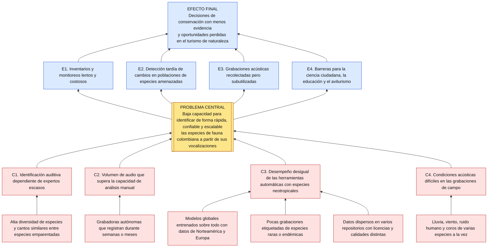
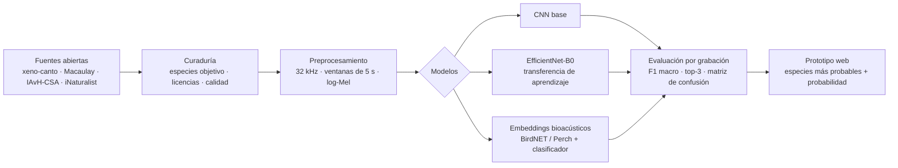
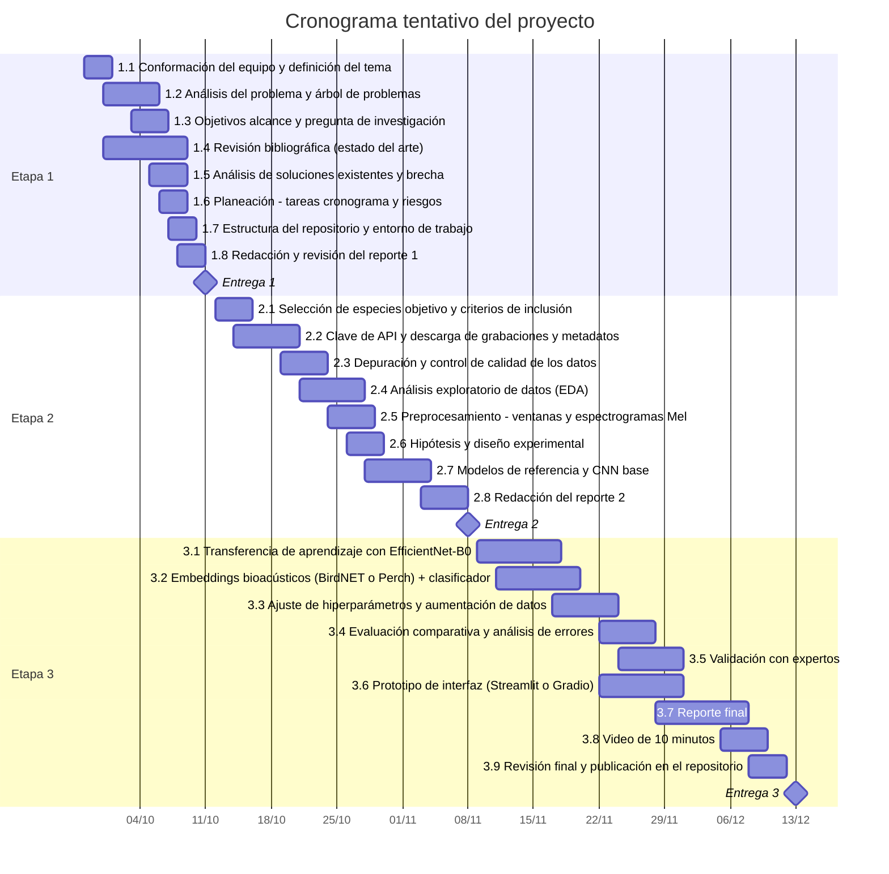

# Identificación de especies de fauna colombiana por su canto mediante aprendizaje profundo

**Reporte de la primera etapa · Entrega 1**

Proyecto 1 · Innovación Tecnológica con IA · **Grupo 4**  
Universidad Icesi · Facultad Barberi de Ingeniería, Diseño y Ciencias Aplicadas  
Integrantes: Wilson Ospina Pérez · Santiago Osorio · Martín Pérez · Adriana Zapata  
Fecha: octubre de 2026

---

**Resumen.** Colombia es el país con más especies de aves del mundo y uno de los más ricos en anfibios, pero buena parte de esa fauna se detecta con más facilidad por el oído que por la vista. Identificar especies por su canto exige expertos escasos, y el monitoreo acústico pasivo produce muchas más horas de audio de las que una persona puede escuchar. Este proyecto propone un sistema basado en aprendizaje profundo que, a partir de una grabación, estime qué especie está vocalizando y con qué probabilidad. En esta primera etapa se analiza el problema con un árbol de causas y efectos, se definen los objetivos y el alcance, se revisa el estado del arte —desde BirdNET hasta la competencia BirdCLEF+ 2025, evaluada con grabaciones del Magdalena Medio colombiano— y se planifican las actividades. La revisión muestra que las redes convolucionales sobre espectrogramas Mel y la transferencia de aprendizaje desde modelos bioacústicos preentrenados son el enfoque dominante, pero también que su desempeño cae con especies poco documentadas, grabaciones ruidosas y cambios de dominio, condiciones típicas del Neotrópico. Con base en ello se propone comparar una CNN entrenada desde cero, una EfficientNet preentrenada y clasificadores sobre *embeddings* bioacústicos, evaluados con particiones por grabación para evitar fuga de información.

**Índice de términos.** Bioacústica, aprendizaje profundo, espectrograma Mel, monitoreo acústico pasivo, transferencia de aprendizaje, biodiversidad de Colombia.

---

## Contenido

- [I. Introducción](#i-introducción)
- [II. Análisis del problema](#ii-análisis-del-problema)
- [III. Objetivos](#iii-objetivos)
- [IV. Árbol de problemas](#iv-árbol-de-problemas)
- [V. Estado del arte](#v-estado-del-arte)
- [VI. Metodología propuesta](#vi-metodología-propuesta)
- [VII. Plan de actividades y cronograma](#vii-plan-de-actividades-y-cronograma)
- [VIII. Referencias](#viii-referencias)

---

## I. Introducción

Colombia ocupa el primer lugar mundial en diversidad de aves: el Sistema de Información sobre Biodiversidad de Colombia (SiB Colombia) reporta 1.954 especies, de las cuales cerca de 82 son endémicas y unas 158 migratorias [1]. En el conteo mundial *Global Big Day* de mayo de 2026, el país volvió a ocupar el primer puesto con 1.566 especies registradas en un solo día [1]. A esta riqueza se suma una fauna de anfibios, insectos y mamíferos que se comunica mediante sonidos y que, en muchos casos, es más fácil de escuchar que de ver; solo entre los anfibios, más de 300 especies presentes en el país están amenazadas, según la evaluación global de la UICN divulgada por el Instituto Humboldt [2].

La bioacústica computacional aprovecha esas vocalizaciones para monitorear la biodiversidad. Grabadoras autónomas instaladas en campo registran el paisaje sonoro durante semanas o meses, y los modelos de aprendizaje profundo —en particular las redes convolucionales aplicadas a espectrogramas— se han convertido en la herramienta estándar para detectar y clasificar especies en esos audios [3]. En Colombia, el Instituto Humboldt ya adapta modelos preentrenados para el monitoreo acústico, pero advierte que el Neotrópico está menos documentado que las regiones templadas y que los modelos cometen más errores con especies que tienen pocos ejemplos de entrenamiento [4].

Este proyecto busca construir un sistema que, a partir de una grabación, identifique la especie que vocaliza, con énfasis en fauna colombiana. El presente reporte corresponde a la primera etapa: análisis del problema (secciones II a IV), estado del arte (sección V), metodología propuesta (sección VI) y planeación (sección VII).

## II. Análisis del problema

### A. Contexto y situación actual

El monitoreo de fauna en Colombia depende en gran medida de inventarios presenciales realizados por especialistas. Cuando se usan grabadoras, el cuello de botella se traslada al análisis: revisar manualmente los audios es lento y tedioso [4]. Existen herramientas automáticas de uso global, como BirdNET o Merlin Sound ID, pero su desempeño depende de la región y de la especie: en una evaluación global, BirdNET detectó en Centro y Suramérica menos de la mitad de las vocalizaciones anotadas por expertos (exhaustividad de 0,46 con un umbral de confianza de 0,1) [5]. Su cobertura también depende de los datos disponibles: Merlin necesita más de 150 grabaciones para incluir una especie, y solo cerca del 20 % de las aves del mundo las tiene [6]. Además, el Neotrópico está menos documentado que las regiones templadas [4].

### B. Planteamiento del problema

> **Baja capacidad para identificar de forma rápida, confiable y escalable las especies de fauna colombiana a partir de sus vocalizaciones.**

La identificación auditiva depende de expertos escasos; el volumen de audio que generan las grabadoras supera la capacidad de análisis manual; las herramientas automáticas existentes tienen menor cobertura y exhaustividad para especies neotropicales; y las grabaciones de campo tienen ruido y coros superpuestos de varias especies. Como resultado, los inventarios son lentos y costosos, los cambios en las poblaciones se detectan tarde, los datos acústicos ya recolectados se subutilizan y las personas no expertas —ciudadanos, docentes, guías de aviturismo— tienen pocas herramientas confiables para reconocer lo que escuchan.

### C. Actores involucrados

| Actor | Necesidad o interés | Cómo lo afecta el problema |
|---|---|---|
| Investigadores y entidades ambientales (Instituto Humboldt, CAR, Parques Nacionales) | Monitorear especies y ecosistemas con evidencia actualizada | Análisis manual lento; datos acústicos sin procesar |
| Comunidades, guías y operadores de aviturismo | Reconocer especies en campo y ofrecer mejores experiencias | Dependencia de expertos; herramientas con baja cobertura local |
| Ciencia ciudadana (eBird, iNaturalist, xeno-canto) | Registrar observaciones correctamente identificadas | Errores de identificación y registros sin especie |
| Docentes y estudiantes | Recursos de educación ambiental | Pocas herramientas en español adaptadas a la fauna local |
| Equipo del proyecto (Grupo 4) | Aplicar IA a un problema real con datos abiertos | — |

### D. Pregunta de investigación

¿Puede un modelo de aprendizaje profundo, entrenado con grabaciones abiertas de especies de Colombia, identificar la especie que vocaliza en una grabación con un desempeño suficiente (meta preliminar: F1 macro ≥ 0,80 en grabaciones no vistas) para apoyar tareas de monitoreo, ciencia ciudadana y educación?

**Hipótesis preliminares** (se formalizan en la Entrega 2 y se ponen a prueba en las Entregas 2 y 3):

1. Los modelos que parten de representaciones preentrenadas —EfficientNet sobre ImageNet o *embeddings* de modelos bioacústicos— superan a una CNN entrenada desde cero cuando hay pocas grabaciones por especie [7], [8].
2. La aumentación de datos (máscaras de tiempo y frecuencia, mezcla de ruido) mejora el desempeño en las especies con menos grabaciones [7], [9].
3. El desempeño medido con particiones por grabación es menor que el medido con particiones aleatorias por ventana, lo que evidencia la fuga de información de este último esquema.

### E. Justificación

- **Relevancia:** la información acústica es una de las formas más costo-efectivas de monitorear fauna, y Colombia es un país prioritario para la conservación por su biodiversidad.
- **Viabilidad técnica:** existen datos abiertos con licencias Creative Commons que varían por archivo (xeno-canto, iNaturalist) y colecciones científicas a las que se accede mediante solicitud (Macaulay Library, Colección de Sonidos Ambientales del Instituto Humboldt), además de modelos preentrenados de libre acceso y librerías maduras (PyTorch, librosa) [8], [10]–[12].
- **Brecha:** los modelos globales tienen menor cobertura y desempeño variable para especies neotropicales poco documentadas [4], [5], [6]; un modelo enfocado en especies colombianas y evaluado con rigor aporta evidencia sobre ese vacío.
- **Impacto social:** una herramienta en español, gratuita y fácil de usar apoya la ciencia ciudadana, la educación ambiental y el aviturismo.

### F. Alcance y delimitación

El problema abarca toda la fauna que vocaliza, pero el proyecto se concentra en las **aves**: es el grupo con más grabaciones etiquetadas y con mejores resultados en el estado del arte, mientras que anfibios e insectos siguen siendo difíciles por falta de datos [13], [14].

| Dentro del alcance | Fuera del alcance |
|---|---|
| Clasificación de **una especie principal por grabación** (ventanas de 5 s agregadas por grabación) | Detección de múltiples especies superpuestas en paisajes sonoros largos (se discute como trabajo futuro) |
| **Aves** de Colombia como grupo principal; anfibios como extensión opcional si los datos lo permiten | Insectos y mamíferos |
| Entre **20 y 30 especies objetivo** con al menos 30 grabaciones de buena calidad en fuentes abiertas (lista final en la Entrega 2) | Cobertura nacional de todas las especies |
| Prototipo web de demostración (subir un audio y obtener las especies más probables) | Aplicación móvil en producción o despliegue en grabadoras de campo |

> **Región prioritaria:** la lista final de especies se define en la tarea 2.1. La opción preferida es el Valle del Cauca (Cali y los Farallones), porque permitiría probar el modelo con grabaciones propias de la región.

## III. Objetivos

### Objetivo general

Desarrollar un prototipo basado en aprendizaje profundo que identifique, a partir de una grabación de audio, la especie de ave de Colombia que vocaliza, con el fin de apoyar el monitoreo de la biodiversidad, la ciencia ciudadana y la educación ambiental.

### Objetivos específicos

| # | Objetivo específico | Indicador de cumplimiento (meta) | Entrega |
|---|---|---|---|
| OE1 | Construir un conjunto de datos depurado de grabaciones etiquetadas de especies objetivo a partir de fuentes abiertas, documentando licencias y autores. | 20–30 especies con ≥ 30 grabaciones cada una; 100 % de las grabaciones con licencia y autor registrados | 2 |
| OE2 | Implementar un *pipeline* reproducible de preprocesamiento (remuestreo, ventanas de 5 s, reducción de ruido opcional y espectrogramas Mel). | Pipeline ejecutable con un solo comando y cubierto por pruebas automáticas | 1–2 |
| OE3 | Entrenar y comparar al menos tres enfoques de clasificación: CNN base, EfficientNet preentrenada y *embeddings* bioacústicos con un clasificador. | Tres modelos entrenados con la misma partición y comparados con las mismas métricas | 2–3 |
| OE4 | Evaluar los modelos con particiones por grabación y métricas estándar, y analizar los errores por especie. | F1 macro ≥ 0,80 y exactitud top-3 ≥ 0,90 en prueba (meta a recalibrar tras el EDA); matriz de confusión y análisis de errores | 3 |
| OE5 | Desarrollar una interfaz de demostración que muestre las especies más probables para un audio cargado por el usuario. | Prototipo funcional que responde en menos de 10 s por minuto de audio en CPU | 3 |

## IV. Árbol de problemas

El árbol se lee de abajo hacia arriba: las **causas** (rojo) originan el **problema central** (amarillo), que a su vez produce los **efectos** (azul).

*Figura 1. Árbol de problemas. Versión en imagen: [`figuras/arbol_problemas.png`](figuras/arbol_problemas.png).*

**Causas.** La identificación depende de expertos porque la diversidad de especies es alta y muchas emiten cantos parecidos (C1). Las grabadoras autónomas multiplican el volumen de audio disponible (C2). Las herramientas automáticas tienen desempeño desigual porque fueron entrenadas mayoritariamente con datos de otras regiones, hay pocas grabaciones de especies raras y los datos colombianos están dispersos (C3). Además, las grabaciones de campo incluyen ruido ambiental y vocalizaciones superpuestas (C4).

**Efectos.** El problema hace que los inventarios sean lentos y costosos (E1), que las alertas sobre especies amenazadas lleguen tarde (E2), que los datos acústicos ya recolectados no se aprovechen (E3) y que los no expertos tengan barreras para participar (E4). En conjunto, las decisiones de conservación se toman con menos evidencia y se pierden oportunidades en el turismo de naturaleza.

### Del árbol de problemas a los objetivos

| Causa | Medio que propone el proyecto | Objetivo |
|---|---|---|
| C1. Dependencia de expertos | Modelo que sugiere las especies más probables para que el experto valide en lugar de escuchar todo | OE3, OE5 |
| C2. Volumen de audio | *Pipeline* automático de segmentación y clasificación por ventanas | OE2 |
| C3. Desempeño desigual con especies neotropicales | Conjunto de datos de especies colombianas y transferencia de aprendizaje para pocas grabaciones | OE1, OE3 |
| C4. Condiciones acústicas difíciles | Reducción de ruido, aumentación de datos y evaluación por especie | OE2, OE4 |

## V. Estado del arte

### A. Criterios de la revisión

Se priorizaron trabajos publicados desde 2020 sobre identificación automática de especies por sonido con aprendizaje profundo, con preferencia por estudios en el trópico o con datos de Colombia, revisiones de referencia, conjuntos de datos abiertos y herramientas de uso actual. Para cada trabajo se resumen el objetivo, los datos, el método, los resultados y las limitaciones relevantes para este proyecto.

### B. Trabajos revisados

**1. Revisión de bioacústica computacional con aprendizaje profundo [3].** Stowell revisó 162 trabajos publicados desde 2016 y describe la "receta estándar" del área: espectrogramas de magnitud en escala logarítmica, a menudo con eje de frecuencia pseudologarítmico (Mel o CQT) aunque sin consenso sobre el mejor formato, como entrada de redes convolucionales, en muchos casos arquitecturas genéricas como ResNet o VGG, con aumentación de datos y preentrenamiento como prácticas habituales. Las aves son el grupo más estudiado. Entre los retos abiertos señala los datos escasos y desbalanceados, la generalización ante cambios de dominio, el reconocimiento de especies no vistas, la calibración de las salidas y los sesgos taxonómicos y geográficos de los datos, con insectos y especies de agua dulce poco representados. *Relevancia:* define el enfoque base del proyecto (CNN sobre espectrogramas Mel) y los riesgos que hay que controlar.

**2. BirdNET [10].** Kahl et al. entrenaron una ResNet ancha (alrededor de 27 millones de parámetros) con espectrogramas Mel de 3 s para reconocer 984 especies de aves de Norteamérica y Europa, a partir de grabaciones de xeno-canto y de la Macaulay Library, con aumentación (desplazamientos, ruido y *mixup*). En grabaciones focales alcanzó una precisión promedio media (mAP) de 0,791 y una exactitud top-1 de 0,777; en paisajes sonoros, una tarea más difícil evaluada con otra métrica, obtuvo un F0.5 de 0,414. Los autores identifican el cambio de dominio entre grabaciones focales y paisajes sonoros como un reto principal, junto con el ruido en las etiquetas y la calidad variable de los equipos de grabación. *Relevancia:* es el modelo de referencia del área; su menor desempeño en paisajes sonoros advierte que el proyecto debe evaluar también con grabaciones de campo.

**3. Aves y ranas en paisajes sonoros tropicales [15].** LeBien et al. propusieron un *pipeline* completo para entrenar una CNN multietiqueta con espectrogramas Mel y transferencia de aprendizaje, para 24 especies de aves y ranas de Puerto Rico. Las etiquetas de entrenamiento se obtuvieron de forma semiautomática con detección por plantillas y una interfaz de validación, lo que redujo el etiquetado manual. Con grabaciones de 749 sitios y una prueba sobre 1.000 grabaciones de un minuto en 17 sitios de El Yunque, obtuvieron un mAP de 0,893 entre especies. La mayoría de especies aparecía en menos del 5 % de las grabaciones, lo que muestra el desbalance típico del trópico. *Relevancia:* demuestra la viabilidad en un ecosistema tropical con aves y anfibios, y una estrategia para reducir el costo de etiquetado.

**4. Pocos datos en un bosque hiperdiverso [7].** Sun et al. clasificaron tipos de vocalización de aves, anfibios, insectos y mamíferos en bosques de Borneo con una VGG-19 preentrenada en ImageNet y aumentación (recortes, estiramientos en tiempo y frecuencia y mezcla con ruido de lluvia, motosierras y vehículos). En el experimento con seis tipos de sonido, la exactitud promedio fue de 31 % sin aumentación ni transferencia, 38 % solo con aumentación, 58 % solo con transferencia y 91 % combinando ambas, incluso con pocas muestras por clase. Como limitaciones, entrenamiento y prueba provenían de los mismos sitios y cada corrida usó solo seis clases. *Relevancia:* respalda la combinación de transferencia de aprendizaje y aumentación cuando hay pocas grabaciones por especie (hipótesis 1 y 2).

**5. *Embeddings* bioacústicos globales (Perch) [8].** Ghani et al. evaluaron qué tan bien se transfieren los *embeddings* de distintos modelos a tareas nuevas usando clasificadores lineales simples. El modelo Perch (EfficientNet-B1 entrenada con todo el corpus de aves de xeno-canto) y BirdNET superaron a modelos de audio general como YAMNet, VGGish y AudioMAE, incluso en grupos distintos a las aves: con 32 ejemplos por clase, Perch obtuvo un AUC de 0,96 en especies de ranas y de 0,97 en murciélagos, y el desempeño se mantuvo por encima del azar con solo 4 ejemplos por clase. Un modelo regional de 89 especies rindió peor que los modelos globales. *Relevancia:* sustenta el tercer enfoque del proyecto, clasificadores sobre *embeddings* bioacústicos, adecuado para especies con pocas grabaciones.

**6. Perch 2.0: modelo bioacústico multitaxón [16].** van Merriënboer et al. presentaron Perch 2.0, una EfficientNet-B3 de unos 12 millones de parámetros que recibe 5 s de audio a 32 kHz como espectrograma log-Mel y produce *embeddings* de 1.536 dimensiones. Se entrenó de forma supervisada con más de 1,5 millones de grabaciones de xeno-canto, iNaturalist, Tierstimmenarchiv y FSD50K, que cubren 14.597 especies de aves, anfibios, insectos y mamíferos. Supera a Perch 1.0 en el banco de pruebas BirdSet (ROC-AUC de 0,907 frente a 0,839) y en BEANS, y se transfiere bien con pocos ejemplos incluso a sonidos marinos, casi ausentes de su entrenamiento. Los autores concluyen que el aprendizaje supervisado a gran escala sigue siendo dominante en bioacústica y que sus *embeddings* son linealmente separables, lo que facilita entrenar clasificadores simples. Es un preprint, aún sin revisión por pares. *Relevancia:* es el candidato más reciente para el enfoque de *embeddings* del proyecto y, al incluir anfibios, para la posible extensión a ese grupo.

**7. AnuraSet: anuros neotropicales [13].** Cañas et al. publicaron un conjunto abierto de 1.612 grabaciones de un minuto (unas 27 horas) de monitoreo acústico pasivo en cuatro sitios del Cerrado y la Mata Atlántica de Brasil, con 42 especies de anuros y 93.378 muestras de 3 s. El mejor de sus modelos de referencia (ResNet-152 sobre espectrogramas Mel con SpecAugment) obtuvo un F1 macro de 37,8 % en total, de 68,4 % en especies frecuentes y de solo 15,7 % en especies raras, lo que evidencia el efecto del desbalance y de los coros superpuestos. *Relevancia:* muestra la dificultad de los anfibios neotropicales y justifica limitar el alcance inicial a aves, dejando los anfibios como extensión.

**8. BirdCLEF+ 2025 en el Magdalena Medio, Colombia [14].** La edición 2025 de BirdCLEF evaluó la identificación de 206 especies de aves, anfibios, mamíferos e insectos en 705 paisajes sonoros de un minuto grabados en la Reserva Natural El Silencio y la zona de Barbacoas, en el Magdalena Medio colombiano. Para entrenar se dispuso de más de 38.000 grabaciones etiquetadas, provenientes sobre todo de xeno-canto, iNaturalist y la Colección de Sonidos Ambientales del Instituto Humboldt. La mejor solución alcanzó un ROC-AUC macro de 0,930. Entre las soluciones mejor clasificadas predominaron la detección de eventos sonoros, las CNN como EfficientNet, el preentrenamiento con xeno-canto, el pseudoetiquetado de grabaciones sin etiquetar y la aumentación tipo *mixup*. Por grupo, el ROC-AUC promedio de los 25 mejores equipos fue alto en aves (0,936) y menor en anfibios (0,840) e insectos (0,667), por falta de datos e incertidumbre taxonómica. *Relevancia:* es el antecedente más cercano al proyecto por su ubicación en Colombia y confirma tanto la viabilidad para aves como la dificultad de otros grupos.

**9. Desempeño de BirdNET en el mundo [5], [17].** Pérez-Granados revisó las aplicaciones, el desempeño y las dificultades de BirdNET [17]. Después, Funosas et al. evaluaron BirdNET con 4.224 paisajes sonoros de un minuto (unas 70 horas) de 67 sitios en seis regiones continentales, anotados por expertos locales (1.102 especies), y compararon precisión y exhaustividad con distintos umbrales de confianza. Con un umbral de 0,1, la precisión fue relativamente estable entre regiones (0,57–0,71), mientras que la exhaustividad varió mucho: 0,24 en África, 0,46 en Centro y Suramérica y 0,52 en Norteamérica. El umbral óptimo cambió mucho entre especies; los autores relacionan los vacíos con la cobertura incompleta de especies y con la menor cantidad de datos de entrenamiento de algunas regiones, y recomiendan ajustar los umbrales por especie y validar manualmente los resultados [5]. *Relevancia:* confirma que un modelo global no garantiza buen desempeño para cualquier especie y que la evaluación por especie es indispensable.

### C. Síntesis comparativa

| Trabajo | Región / taxones | Datos | Método | Resultado principal | Limitación relevante |
|---|---|---|---|---|---|
| Stowell, 2022 [3] | Global / varios | Revisión de 162 trabajos | — | CNN sobre espectrogramas como receta estándar | Sesgos geográficos y taxonómicos; datos escasos |
| Kahl et al., 2021 [10] | Norteamérica y Europa / aves | xeno-canto, Macaulay | ResNet, Mel 3 s, aumentación | mAP 0,791 (focal); F0.5 0,414 (paisaje sonoro) | Cambio de dominio; etiquetas ruidosas |
| LeBien et al., 2020 [15] | Puerto Rico / aves y ranas | 749 sitios; 24 especies | CNN + transferencia; etiquetado semiautomático | mAP 0,893 | Un solo bosque de prueba; desbalance |
| Sun et al., 2022 [7] | Borneo / varios | 3.629 vocalizaciones anotadas | VGG-19 ImageNet + aumentación | 91 % de exactitud combinando ambas técnicas | Mismos sitios en entrenamiento y prueba |
| Ghani et al., 2023 [8] | Global / aves, ranas, murciélagos, mamíferos marinos | xeno-canto (Perch) | *Embeddings* + clasificador lineal | AUC 0,96 en ranas con 32 ejemplos por clase | No evalúa paisajes sonoros completos |
| van Merriënboer et al., 2025 [16] | Global / aves, anfibios, insectos, mamíferos | > 1,5 millones de grabaciones; 14.597 especies | EfficientNet-B3 supervisada; *embeddings* | ROC-AUC 0,907 en BirdSet | Preprint sin revisión por pares |
| Cañas et al., 2023 [13] | Brasil / anuros | 27 h, 42 especies | ResNet-152 + SpecAugment | F1 macro 37,8 % (15,7 % en especies raras) | Desbalance fuerte; coros superpuestos |
| Cañas et al., 2025 [14] | Colombia / aves, anfibios, mamíferos, insectos | 206 especies, > 38.000 grabaciones | CNN/SED, pseudoetiquetado | ROC-AUC macro 0,930 | Insectos y anfibios con bajo desempeño |
| Funosas et al., 2026 [5] | Global (6 regiones) / aves | 4.224 paisajes sonoros de 1 min; 67 sitios; 1.102 especies | BirdNET con distintos umbrales | Precisión 0,57–0,71; exhaustividad 0,24–0,52 según la región | Umbral óptimo distinto por especie; requiere validación |

### D. Análisis de soluciones existentes

| Solución | Tipo | Fortalezas | Limitaciones para este proyecto |
|---|---|---|---|
| **BirdNET** (BirdNET-Analyzer y app) [10], [18] | Modelo y aplicación de uso libre; el repositorio oficial reporta más de 6.500 especies | Amplia cobertura; procesamiento por lotes; base de muchos estudios | Modelos con licencia CC BY-NC-SA 4.0 (uso no comercial); desempeño variable por especie que exige validación [5] |
| **Merlin Sound ID** (Cornell Lab) [6] | Aplicación móvil | Muy fácil de usar en campo; identificación en tiempo real | Requiere más de 150 grabaciones por especie para incluirla; en 2025 aún buscaba datos para ampliar especies en Colombia [6] |
| **Perch 1.0 y 2.0** (Google) [8], [16] | Modelos de *embeddings* bioacústicos | Transferencia con pocos ejemplos; la versión 2.0 incluye anfibios, insectos y mamíferos | Requieren conocimientos de ML; no son aplicaciones para usuarios finales |
| **Soluciones de BirdCLEF+ 2025** [14] | Modelos de competencia | Estado del arte en datos de Colombia | Complejas (ensambles, pseudoetiquetado); pensadas para un concurso, no para uso cotidiano |
| **scikit-maad** [19] | Librería de Python | Análisis de paisajes sonoros e índices acústicos; desarrollada con participación de investigadores del Instituto Humboldt | No clasifica especies por sí misma |

### E. Brecha identificada y oportunidad

1. **Cobertura y desempeño en especies colombianas:** los modelos globales dependen de la cantidad de grabaciones por especie y requieren validación experta [4], [5], [6]. Hace falta evidencia sobre especies colombianas concretas, evaluadas una por una.
2. **Pocos datos por especie:** la combinación de transferencia de aprendizaje, *embeddings* bioacústicos y aumentación es la vía más prometedora cuando hay pocas grabaciones [7], [8], [16], pero se debe comparar contra una línea base.
3. **Evaluación rigurosa:** muchos trabajos reportan resultados con datos de los mismos sitios o grabaciones [7]; el proyecto evaluará con particiones por grabación y analizará el cambio de dominio con grabaciones de campo [10].
4. **Acceso:** las herramientas existentes son técnicas (Perch, scikit-maad) o de cobertura limitada para algunas especies (Merlin); se propone un prototipo en español, abierto y enfocado en especies locales.

## VI. Metodología propuesta

### A. Marco metodológico

Se sigue una adaptación del ciclo CRISP-DM [20] alineada con las tres entregas del curso:

| Fase CRISP-DM | Actividades del proyecto | Entrega |
|---|---|---|
| Comprensión del problema | Análisis del problema, objetivos, estado del arte y planeación | 1 |
| Comprensión y preparación de los datos | Selección de especies, descarga, depuración, EDA y preprocesamiento | 2 |
| Modelado | Modelos de referencia (Entrega 2), transferencia de aprendizaje y *embeddings* (Entrega 3) | 2–3 |
| Evaluación | Comparación con particiones por grabación, análisis de errores, validación con expertos | 3 |
| Despliegue | Prototipo web de demostración | 3 |

*Figura 2. Flujo general del proyecto. El detalle técnico está en [`arquitectura.md`](arquitectura.md).*

### B. Datos

- **Fuente principal:** xeno-canto (API v3, consultas por especie y país) [11]. Complementos: iNaturalist (licencia variable por archivo) y, mediante solicitud de acceso, la Macaulay Library y la Colección de Sonidos Ambientales del Instituto Humboldt.
- **Criterios de inclusión de especies:** presencia en Colombia (con prioridad para el Valle del Cauca), al menos 30 grabaciones de calidad A o B y diversidad de grabadores; se registran licencia y autor de cada archivo.
- **Unidad de análisis:** ventanas de 5 s con 50 % de solapamiento; la predicción de una grabación se obtiene promediando las probabilidades de sus ventanas.

### C. Preprocesamiento

Remuestreo a 32 kHz en mono, segmentación en ventanas de 5 s, reducción espectral de ruido opcional, espectrograma Mel de 128 bandas entre 50 Hz y 14 kHz en decibeles [12], y estandarización por ventana. Ya está implementado en `src/data/preprocess.py` y cubierto por pruebas automáticas.

### D. Modelos a comparar

1. **Referencias simples (Entrega 2):** clasificador de la clase mayoritaria y regresión logística sobre estadísticas de MFCC.
2. **CNN base:** cuatro bloques convolucionales entrenados desde cero (`src/models/cnn_baseline.py`).
3. **Transferencia de aprendizaje:** EfficientNet-B0 preentrenada en ImageNet y ajustada a espectrogramas [21].
4. ***Embeddings* bioacústicos:** representaciones de BirdNET o Perch 2.0 con un clasificador lineal (por ejemplo, regresión logística) [8], [16].

En todos los casos se usarán pesos por clase para el desbalance y aumentación tipo SpecAugment [9].

### E. Protocolo de evaluación

- Partición estratificada **por grabación** en entrenamiento, validación y prueba (70/15/15): ninguna grabación aporta ventanas a más de una partición.
- **Métrica principal:** F1 macro, que pondera por igual a todas las especies. Complementarias: exactitud, exactitud balanceada, exactitud top-3, matriz de confusión y reporte por especie.
- **Prueba de cambio de dominio:** si es posible, un conjunto pequeño de grabaciones propias tomadas en campo.
- **Validación con expertos:** revisión de una muestra de predicciones con ornitólogos o grupos de observación de aves.

### F. Herramientas

Python 3.11, PyTorch, librosa, scikit-learn, pandas, matplotlib, Jupyter o Google Colab (GPU), Git y GitHub para control de versiones, y Streamlit o Gradio para el prototipo.

### G. Consideraciones éticas y de licencias

- Uso académico y no comercial de las grabaciones; no se redistribuyen audios y se cita a cada autor según su licencia.
- No se publicarán coordenadas precisas de especies amenazadas o sujetas a tráfico.
- Si una grabación contiene voces humanas, se recorta o se excluye.
- El prototipo comunicará que sus resultados son sugerencias que no reemplazan la identificación de un experto.

## VII. Plan de actividades y cronograma

El plan cubre las tres entregas del curso. Las fechas son **tentativas** y se calculan desde la fecha de inicio en el archivo [`cronograma.xlsx`](cronograma.xlsx), que contiene las mismas tareas con fechas, duraciones, avance, estado y diagrama de Gantt calculados con fórmulas; al cambiar la fecha de inicio o una duración, todo el plan se actualiza.

### A. Estructura de trabajo

Las dependencias admiten solapamiento: una actividad puede iniciar cuando su predecesora ya está avanzada (relación inicio-inicio con desfase), por eso las fechas se programan con un desfase en días desde el inicio del proyecto.

**Etapa 1 · Planteamiento del problema — Entrega 1 (20 % de la nota)**

| ID | Actividad | Inicio | Fin | Días | Predecesora | Entregable |
|---|---|---|---|---|---|---|
| 1.1 | Conformación del equipo y definición del tema | 28-sep | 30-sep | 3 | — | Tema y repositorio creados |
| 1.2 | Análisis del problema y árbol de problemas | 30-sep | 05-oct | 6 | 1.1 | Secciones II y IV del reporte |
| 1.3 | Objetivos, alcance y pregunta de investigación | 03-oct | 06-oct | 4 | 1.2 | Sección III del reporte |
| 1.4 | Revisión bibliográfica (estado del arte) | 30-sep | 08-oct | 9 | 1.1 | Sección V.B y referencias |
| 1.5 | Análisis de soluciones existentes y brecha | 05-oct | 08-oct | 4 | 1.4 | Secciones V.C a V.E |
| 1.6 | Planeación: tareas, cronograma y riesgos | 06-oct | 08-oct | 3 | 1.3 | Sección VII y cronograma.xlsx |
| 1.7 | Estructura del repositorio y entorno de trabajo | 07-oct | 09-oct | 3 | 1.1 | Carpeta entrega_1 en GitHub |
| 1.8 | Redacción y revisión del reporte 1 | 08-oct | 10-oct | 3 | 1.3, 1.5, 1.6 | docs/reporte_entrega_1.md |
| **H1** | **Entrega 1: reporte de la primera etapa (20 %)** | **11-oct** | — | — | 1.8 | Hito |

**Etapa 2 · Datos y modelos de referencia — Entrega 2 (10 % de la nota)**

| ID | Actividad | Inicio | Fin | Días | Predecesora | Entregable |
|---|---|---|---|---|---|---|
| 2.1 | Selección de especies objetivo y criterios de inclusión | 12-oct | 15-oct | 4 | H1 | Lista de especies |
| 2.2 | Clave de API y descarga de grabaciones y metadatos | 14-oct | 20-oct | 7 | 2.1 | data/raw y metadatos |
| 2.3 | Depuración y control de calidad de los datos | 19-oct | 23-oct | 5 | 2.2 | Conjunto depurado |
| 2.4 | Análisis exploratorio de datos (EDA) | 21-oct | 27-oct | 7 | 2.3 | Notebook de EDA |
| 2.5 | Preprocesamiento: ventanas y espectrogramas Mel | 24-oct | 28-oct | 5 | 2.3 | data/processed + índice |
| 2.6 | Hipótesis y diseño experimental | 26-oct | 29-oct | 4 | 2.4 | Sección de hipótesis |
| 2.7 | Modelos de referencia y CNN base | 28-oct | 03-nov | 7 | 2.5 | Primeras métricas |
| 2.8 | Redacción del reporte 2 | 03-nov | 07-nov | 5 | 2.6, 2.7 | Reporte de la segunda etapa |
| **H2** | **Entrega 2: reporte de la segunda etapa (10 %)** | **08-nov** | — | — | 2.8 | Hito |

**Etapa 3 · Modelado, evaluación y comunicación — Entrega 3 (70 % de la nota)**

| ID | Actividad | Inicio | Fin | Días | Predecesora | Entregable |
|---|---|---|---|---|---|---|
| 3.1 | Transferencia de aprendizaje con EfficientNet-B0 | 09-nov | 17-nov | 9 | H2 | Modelo entrenado |
| 3.2 | Embeddings bioacústicos (BirdNET o Perch) + clasificador | 11-nov | 19-nov | 9 | H2 | Modelo entrenado |
| 3.3 | Ajuste de hiperparámetros y aumentación de datos | 17-nov | 23-nov | 7 | 3.1 | Mejor configuración |
| 3.4 | Evaluación comparativa y análisis de errores | 22-nov | 27-nov | 6 | 3.2, 3.3 | Tablas y figuras de resultados |
| 3.5 | Validación con expertos | 24-nov | 30-nov | 7 | 3.4 | Muestra revisada por expertos |
| 3.6 | Prototipo de interfaz (Streamlit o Gradio) | 22-nov | 30-nov | 9 | 3.1 | Aplicación de demostración |
| 3.7 | Reporte final | 28-nov | 07-dic | 10 | 3.4 | Reporte final |
| 3.8 | Video de 10 minutos | 05-dic | 09-dic | 5 | 3.7 | Video |
| 3.9 | Revisión final y publicación en el repositorio | 08-dic | 11-dic | 4 | 3.7, 3.8 | Repositorio final |
| **H3** | **Entrega 3: reporte final y video (70 %)** | **13-dic** | — | — | 3.9 | Hito |

### B. Diagrama de Gantt

*Figura 3. Diagrama de Gantt del proyecto. Versión en imagen: [`figuras/cronograma_gantt.png`](figuras/cronograma_gantt.png).*

### C. Hitos y entregables

| Hito | Fecha tentativa | Peso | Contenido evaluado |
|---|---|---|---|
| Entrega 1 | 11-oct-2026 | 20 % | Análisis del problema (10 %): problema, objetivos y árbol de problemas · Estado del arte (5 %) · Planeación (5 %) |
| Entrega 2 | 08-nov-2026 | 10 % | Análisis exploratorio de datos (5 %) · Modelos de referencia, hipótesis y experimentos (5 %) |
| Entrega 3 | 13-dic-2026 | 70 % | Reporte final (introducción, metodología, resultados, discusión, conclusiones y referencias) · Video de 10 minutos |

### D. Riesgos y mitigación

| Riesgo | Probabilidad | Impacto | Mitigación |
|---|---|---|---|
| Pocas grabaciones para algunas especies objetivo | Alta | Alto | Elegir especies con ≥ 30 grabaciones; transferencia de aprendizaje y *embeddings*; aumentación |
| Etiquetas débiles (otras especies de fondo en la grabación) | Media | Medio | Filtrar calidad A–B; descartar ventanas silenciosas; revisión manual de una muestra |
| Desbalance entre especies | Alta | Medio | Pesos por clase, F1 macro como métrica principal, muestreo balanceado |
| Cambio de dominio entre grabaciones focales y de campo | Media | Alto | Aumentación con ruido; prueba con grabaciones propias de campo |
| Acceso a los datos: clave y límites de la API de xeno-canto; colecciones que requieren solicitud (Macaulay, Instituto Humboldt) | Media | Medio | Pedir la clave y los accesos al inicio de la Etapa 2; xeno-canto como fuente principal; guardar metadatos localmente; pausas entre solicitudes |
| Capacidad de cómputo limitada | Media | Medio | Google Colab con GPU; modelos compactos; *embeddings* precalculados |
| Disponibilidad del equipo frente a la carga académica | Media | Medio | Asignar al inicio de cada etapa un responsable a las tareas marcadas «Por asignar» en el Excel; reunión semanal corta; un día de holgura antes de cada hito |
| Restricciones de licencia (CC BY-NC) | Baja | Medio | Uso académico no comercial; sin redistribución de audios; registro de atribución |

### E. Seguimiento

El avance se actualiza semanalmente en [`cronograma.xlsx`](cronograma.xlsx) (columnas *% avance* y *Responsable*). El archivo calcula el estado de cada tarea (completada, en curso, pendiente o atrasada) frente a la fecha de corte y el avance ponderado de cada etapa.

## VIII. Referencias

[1] "Colombia vuelve a liderar el mayor conteo internacional de aves del mundo," *Forbes Colombia*, 15 de mayo de 2026. Cifras del Sistema de Información sobre Biodiversidad de Colombia (SiB Colombia). [En línea]. Disponible: https://forbes.co/2026/05/15/actualidad/colombia-vuelve-a-liderar-el-mayor-conteo-internacional-de-aves-del-mundo/

[2] Instituto Humboldt, "Frenar la extinción de especies es posible, pero se acaba el tiempo para los anfibios," *El Espectador*, 27 de diciembre de 2023. [En línea]. Disponible: https://www.elespectador.com/ambiente/bibo/frenar-la-extincion-de-especies-es-posible-pero-se-acaba-el-tiempo-para-los-anfibios/

[3] D. Stowell, "Computational bioacoustics with deep learning: a review and roadmap," *PeerJ*, vol. 10, art. e13152, 2022, doi: 10.7717/peerj.13152.

[4] J. S. Cañas *et al.*, "Inteligencia artificial para la conservación y uso sostenible de la biodiversidad, una visión desde Colombia," arXiv:2503.14543, 2025.

[5] D. Funosas, E. Sebastián-González, J. Morant *et al.*, "A global assessment of BirdNET performance: Differences among continents, biomes, and species," *Ecological Indicators*, vol. 182, art. 114550, 2026, doi: 10.1016/j.ecolind.2025.114550.

[6] Cornell Lab of Ornithology, "Help expand Merlin in Colombia," *Merlin Bird ID*, 2025. [En línea]. Disponible: https://www.merlinbirds.org/help-expand-merlin-in-colombia/

[7] Y. Sun, T. M. Maeda, C. Solís-Lemus, D. Pimentel-Alarcón y Z. Buřivalová, "Classification of animal sounds in a hyperdiverse rainforest using convolutional neural networks with data augmentation," *Ecological Indicators*, vol. 145, art. 109621, 2022, doi: 10.1016/j.ecolind.2022.109621.

[8] B. Ghani, T. Denton, S. Kahl y H. Klinck, "Global birdsong embeddings enable superior transfer learning for bioacoustic classification," *Scientific Reports*, vol. 13, art. 22876, 2023, doi: 10.1038/s41598-023-49989-z.

[9] D. S. Park *et al.*, "SpecAugment: A simple data augmentation method for automatic speech recognition," en *Proc. Interspeech*, 2019, pp. 2613–2617.

[10] S. Kahl, C. M. Wood, M. Eibl y H. Klinck, "BirdNET: A deep learning solution for avian diversity monitoring," *Ecological Informatics*, vol. 61, art. 101236, 2021, doi: 10.1016/j.ecoinf.2021.101236.

[11] Xeno-canto Foundation, "xeno-canto: Sharing wildlife sounds from around the world." [En línea]. Disponible: https://xeno-canto.org

[12] B. McFee *et al.*, "librosa: Audio and music signal analysis in Python," en *Proc. 14th Python in Science Conference (SciPy)*, 2015, pp. 18–25.

[13] J. S. Cañas *et al.*, "A dataset for benchmarking Neotropical anuran calls identification in passive acoustic monitoring," *Scientific Data*, vol. 10, art. 771, 2023, doi: 10.1038/s41597-023-02666-2.

[14] J. S. Cañas *et al.*, "Overview of BirdCLEF+ 2025: Multi-taxonomic sound identification in the Middle Magdalena, Colombia," en *Working Notes of CLEF 2025*, CEUR Workshop Proceedings, vol. 4038, 2025. [En línea]. Disponible: https://ceur-ws.org/Vol-4038/paper_232.pdf

[15] J. LeBien *et al.*, "A pipeline for identification of bird and frog species in tropical soundscape recordings using a convolutional neural network," *Ecological Informatics*, vol. 59, art. 101113, 2020, doi: 10.1016/j.ecoinf.2020.101113.

[16] B. van Merriënboer, V. Dumoulin, J. Hamer, L. Harrell, A. Burns y T. Denton, "Perch 2.0: The Bittern Lesson for Bioacoustics," arXiv:2508.04665, 2025.

[17] C. Pérez-Granados, "BirdNET: applications, performance, pitfalls and future opportunities," *Ibis*, vol. 165, no. 3, pp. 1068–1075, 2023, doi: 10.1111/ibi.13193.

[18] BirdNET Team, "BirdNET-Analyzer," repositorio de software. [En línea]. Disponible: https://github.com/birdnet-team/BirdNET-Analyzer

[19] J. S. Ulloa, S. Haupert, J. F. Latorre, T. Aubin y J. Sueur, "scikit-maad: An open-source and modular toolbox for quantitative soundscape analysis in Python," *Methods in Ecology and Evolution*, vol. 12, no. 12, pp. 2334–2340, 2021, doi: 10.1111/2041-210X.13711.

[20] P. Chapman *et al.*, *CRISP-DM 1.0: Step-by-step data mining guide*. SPSS Inc., 2000.

[21] M. Tan y Q. V. Le, "EfficientNet: Rethinking model scaling for convolutional neural networks," en *Proc. 36th International Conference on Machine Learning (ICML)*, 2019, pp. 6105–6114.
