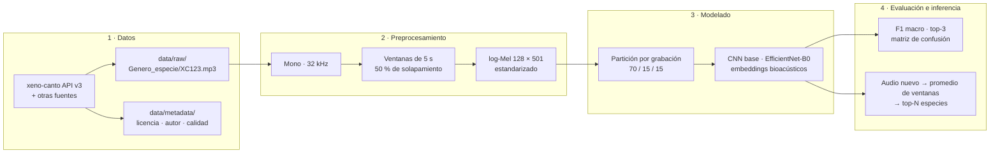

# 🏗️ Arquitectura y diseño del modelo

Diseño técnico del sistema, versión de la Entrega 2 (en construcción). Parte del diseño de la Entrega 1 y se ajustará con los resultados del análisis exploratorio y de los modelos de referencia.

## 1. Flujo de extremo a extremo



| Paso | Módulo | Comando |
|---|---|---|
| Ranking de especies de la región | `src/data/download.py` | `python -m src.main especies --region valle_del_cauca` |
| Descarga | `src/data/download.py` | `python -m src.main download --lista data/especies_objetivo.txt` |
| Preprocesamiento | `src/data/preprocess.py` | `python -m src.main preprocess` |
| Dataset y particiones | `src/data/dataset.py` | (lo usa el entrenamiento) |
| Modelos | `src/models/cnn_baseline.py` | — |
| Entrenamiento | `src/training/train.py` | `python -m src.main train` |
| Evaluación | `src/evaluation/evaluate.py` | `python -m src.main evaluate --checkpoint ...` |
| Inferencia | `src/inference/predict.py` | `python -m src.main predict --audio ... --checkpoint ...` |
| Utilidades | `src/utils/helpers.py` | — |

## 2. Datos

```
data/raw/<Genero_especie>/<id>.mp3          # la carpeta define la etiqueta
data/processed/<Genero_especie>/<id>_000.npy  # una ventana = un espectrograma
data/processed/index.csv                      # path, label, recording_id, segment[, split]
data/processed/audio_config.json              # parámetros usados (se reutilizan en la inferencia)
```

- **Etiqueta:** nombre de la carpeta de la especie (`Turdus_fuscater`).
- **`recording_id`:** identifica la grabación de origen de cada ventana; se usa para agrupar en la partición.
- **`split`:** lo agrega el entrenamiento la primera vez (`train` / `val` / `test`) y queda guardado para que todas las corridas comparen sobre la misma partición.

## 3. Preprocesamiento

| Parámetro | Valor | Justificación |
|---|---|---|
| Frecuencia de muestreo | 32 kHz, mono | Cubre hasta 16 kHz, donde está la energía de la mayoría de cantos; valor usual en BirdCLEF |
| Duración de ventana | 5 s | Contiene frases completas de canto; es la unidad usada en BirdCLEF |
| Solapamiento | 50 % (salto de 2,5 s) | Evita cortar vocalizaciones en el borde de una ventana |
| FFT / salto | 1024 / 320 muestras (10 ms) | Buen compromiso entre resolución temporal y frecuencial |
| Bandas Mel | 128, de 50 Hz a 14 kHz | Reduce parte del ruido de muy baja frecuencia (viento, tráfico) |
| Escala | dB relativos al máximo, rango de 80 dB | Comprime el rango dinámico |
| Normalización | media 0, desviación 1 por ventana | Reduce diferencias de volumen entre grabadoras |
| Reducción de ruido | opcional (`--reduce-noise`) | Se evaluará su efecto en la Entrega 2 |

Forma de cada ventana: **128 × 501** (bandas Mel × cuadros de tiempo).

## 4. Modelos

### 4.1 CNN base (`cnn_baseline`)

| Capa | Salida (para 128 × 501) |
|---|---|
| Entrada | 1 × 128 × 501 |
| Bloque 1: 2 × (Conv 3×3 → BatchNorm → ReLU), MaxPool 2×2, Dropout | 32 × 64 × 250 |
| Bloque 2 | 64 × 32 × 125 |
| Bloque 3 | 128 × 16 × 62 |
| Bloque 4 | 256 × 8 × 31 |
| *Pooling* promedio global | 256 |
| Dropout 0,3 + capa lineal | N especies |

≈ 1,2 millones de parámetros con 20 especies. El *pooling* global permite procesar ventanas de distinta duración.

### 4.2 Transferencia de aprendizaje (`efficientnet_b0`)

EfficientNet-B0 de `torchvision` con pesos de ImageNet; el espectrograma se replica en 3 canales y se reemplaza la capa final por una de N especies. Se ajusta todo el modelo con una tasa de aprendizaje menor.

### 4.3 *Embeddings* bioacústicos (Entrega 3)

Se extraen vectores de características con un modelo bioacústico preentrenado (BirdNET o Perch 2.0) y se entrena un clasificador lineal (por ejemplo, regresión logística). Es la opción recomendada cuando hay pocas grabaciones por especie (ver estado del arte, trabajos 5 y 6).

## 5. Entrenamiento

| Elemento | Configuración inicial |
|---|---|
| Pérdida | Entropía cruzada con pesos por clase (inverso de la frecuencia) |
| Optimizador | AdamW, tasa de aprendizaje 1e-3, *weight decay* 1e-4 |
| Programación de la tasa | `ReduceLROnPlateau` sobre el F1 macro de validación (factor 0,5) |
| Lote / épocas | 32 / hasta 30, con parada temprana (paciencia 5) |
| Aumentación | Máscaras aleatorias de frecuencia y tiempo (tipo SpecAugment); *mixup* y mezcla de ruido en la Entrega 3 |
| Selección del modelo | Mejor F1 macro en validación |
| Reproducibilidad | Semilla fija (42) y partición guardada en `index.csv` |

Salidas de cada corrida (en `experiments/`): `checkpoints/<corrida>.pt`, `logs/<corrida>.log`, `logs/<corrida>_history.csv` y `results/<corrida>_train_summary.json`.

## 6. Evaluación

- **Partición por grabación** con `StratifiedGroupKFold`: ninguna grabación aparece en dos particiones, lo que evita la fuga de información entre ventanas de un mismo audio.
- **Métrica principal:** F1 macro. **Complementarias:** exactitud, exactitud balanceada, precisión y exhaustividad macro, exactitud top-3.
- **Artefactos:** `results/<corrida>_<split>_metricas.json`, `..._por_especie.csv` y `..._matriz_confusion.png`.

## 7. Inferencia

1. Cargar el audio con la misma configuración del entrenamiento (guardada en el checkpoint).
2. Dividirlo en ventanas de 5 s y calcular la probabilidad de cada especie por ventana.
3. Promediar las probabilidades y devolver las N especies más probables.

## 8. Decisiones pendientes (Entrega 2)

- Lista final de especies y región priorizada.
- Efecto de la reducción de ruido y del descarte de ventanas silenciosas.
- Agregación por grabación: promedio frente a máximo de probabilidades.
- Modelo bioacústico para los *embeddings* (BirdNET o Perch 2.0) según licencia y facilidad de uso.
