# Identificación de especies de fauna colombiana por su canto mediante aprendizaje profundo

**Reporte de la segunda etapa · Entrega 2**

Proyecto 1 · Innovación Tecnológica con IA · **Grupo 4**  
Universidad Icesi · Facultad Barberi de Ingeniería, Diseño y Ciencias Aplicadas  
Integrantes: Wilson Ospina Pérez · Santiago Osorio · Martín Pérez · Adriana Zapata  
Fecha de entrega: 19 de noviembre de 2026

| Criterio de la rúbrica | Peso | Secciones |
|---|---|---|
| Análisis exploratorio: calidad de la exploración y justificación de la selección de datos y variables | 5 % | II y III |
| Modelos de referencia y experimentos: planteamiento de hipótesis y pruebas iniciales | 5 % | IV y V |

---

**Resumen.** En esta segunda etapa construimos el conjunto de datos y los modelos de referencia del proyecto. Elegimos 15 especies de aves presentes en el Valle del Cauca, descargamos 870 grabaciones de xeno-canto y conservamos 822 tras la depuración (665 minutos, 178 grabadores), que convertimos en 11.159 ventanas de 5 s representadas como espectrogramas log-Mel. El análisis exploratorio mostró un conjunto casi balanceado, con etiquetas débiles, duraciones muy variables y ruido de baja frecuencia asociado a algunas especies; un agrupamiento no supervisado apenas separa las especies (pureza 0,26). Formalizamos cuatro hipótesis y pusimos a prueba tres. Con partición por grabación, el mejor clasificador clásico sobre MFCC (SVM) alcanza un F1 macro de 0,62 en prueba y una CNN liviana sobre espectrogramas, 0,73 por ventana y 0,82 por grabación, lo que apoya la hipótesis de que la CNN supera a los modelos clásicos. Particionar al azar por ventana sobrestima el F1 macro entre 0,12 y 0,34, lo que confirma la fuga de información. No encontramos evidencia de que la aumentación favorezca a las especies con menos datos. En la Etapa 3 buscaremos mejorar este resultado con transferencia de aprendizaje y *embeddings* bioacústicos, y mediremos el avance con intervalos de confianza, con una meta aproximada de F1 macro de 0,70.

---

## I. Introducción

En la [Entrega 1](../../entrega_1/docs/reporte_entrega_1.md) planteamos el problema —la baja capacidad para identificar de forma rápida, confiable y escalable las especies de fauna colombiana a partir de sus vocalizaciones— y la pregunta de investigación: ¿puede un modelo de aprendizaje profundo, entrenado con grabaciones abiertas, identificar la especie que vocaliza en grabaciones no vistas, con un F1 macro aproximado de 0,70 o más? En la Entrega 1 la meta preliminar era 0,80; en la sección V.C explicamos por qué la recalibramos a un valor aproximado de 0,70. Según el alcance del curso trabajamos con un subconjunto de 10 a 20 especies de aves, con el Valle del Cauca como región preferida.

En esta segunda etapa pasamos del plan a los datos. Elegimos 15 especies objetivo, descargamos y depuramos sus grabaciones, hicimos el análisis exploratorio, formalizamos las hipótesis y entrenamos los modelos de referencia con los que compararemos los modelos de la Etapa 3. Todo el flujo es reproducible con los comandos de [`guia_etapa_2.md`](guia_etapa_2.md); los notebooks [`02_eda.ipynb`](../notebooks/02_eda.ipynb) y [`03_modelos_referencia.ipynb`](../notebooks/03_modelos_referencia.ipynb) contienen el detalle, y las tablas que citamos están en [`experiments/results/`](../experiments/results/).

## II. Datos

### A. Fuentes y consulta (tarea 2.1)

Usamos **xeno-canto** [11] por medio de su API v3 [22], que entrega los metadatos de cada grabación (especie, calidad, duración, autor, licencia, coordenadas, especies de fondo) y el enlace al audio. Hicimos tres consultas, todas para el grupo de aves en Colombia:

| Consulta | Fecha | Alcance | Resultado |
|---|---|---|---|
| Ranking regional | 18-oct-2026 | Rectángulo del Valle del Cauca (3,08°–5,02° N; 77,55°–75,70° O), solo metadatos | 366 especies; ninguna alcanza 30 grabaciones de calidad A o B |
| Ranking nacional | 18-oct-2026 | Toda Colombia, solo metadatos | 1.552 especies; 267 con 30 o más grabaciones A/B |
| Especies objetivo | 12-nov-2026 | Las 15 especies elegidas, toda Colombia | 2.724 grabaciones de 293 grabadores (1990–2026) |

**Convención de calidad.** xeno-canto califica cada grabación con una letra de A a E. En este trabajo "A/B" significa "calidad A o B", las dos únicas que usamos:

| Calidad | Significado | ¿La usamos? |
|---|---|---|
| **A** | Excelente: vocalización clara, casi sin ruido de fondo | Sí |
| **B** | Buena: vocalización clara, con algo de ruido | Sí |
| C | Aceptable: ruido o solapamiento moderado | No |
| D | Mala: ruido alto, vocalización poco distinguible | No |
| E | Muy mala | No |

El hallazgo que definió la estrategia de datos es que **la región sola no alcanza**: en el rectángulo del Valle ninguna especie identificada llega al mínimo de 30 grabaciones A/B que fijamos en la Entrega 1. Por eso aplicamos el mínimo sobre el conteo nacional y usamos el ranking regional solo para confirmar que la especie está presente en el Valle.

### B. Selección de especies objetivo (tarea 2.1)

Aplicamos cuatro criterios, sustentados en [`ranking_especies.csv`](../experiments/results/ranking_especies.csv) (nacional) y [`ranking_especies_valle.csv`](../experiments/results/ranking_especies_valle.csv) (regional):

1. **Datos suficientes:** al menos 30 grabaciones de calidad A o B en Colombia.
2. **Presencia regional:** al menos 2 grabaciones A/B dentro del rectángulo del Valle del Cauca.
3. **Diversidad de grabadores:** más de 20 autores distintos, para que el modelo no aprenda el equipo o el sitio de una sola persona.
4. **Dificultad realista:** incluir pares de especies emparentadas con cantos parecidos, para que la evaluación sea exigente.

De las 267 especies que cumplen el primer criterio elegimos 15, dentro del rango de 10 a 20 que pide el curso:

| Especie | Nombre en inglés | A/B en Colombia | Grabadores | A/B en el Valle | Por qué la incluimos |
|---|---|---|---|---|---|
| *Henicorhina leucophrys* | Grey-breasted Wood Wren | 393 | 84 | 5 | La especie con más datos; par con *H. leucosticta* |
| *Troglodytes aedon* | House Wren | 214 | 86 | 10 | Común en zonas urbanas y rurales; útil para ciencia ciudadana |
| *Zonotrichia capensis* | Rufous-collared Sparrow | 159 | 68 | 6 | Muy común y fácil de reconocer; útil para validar con no expertos |
| *Pheugopedius mystacalis* | Whiskered Wren | 153 | 64 | 5 | Cucarachero de canto complejo; amplía la familia Troglodytidae |
| *Myadestes ralloides* | Andean Solitaire | 144 | 64 | 6 | Canto tonal característico de bosque andino |
| *Synallaxis azarae* | Azara's Spinetail | 130 | 59 | 3 | Par con *S. albescens* |
| *Rupornis magnirostris* | Roadside Hawk | 123 | 59 | 7 | Única rapaz; vocalización muy distinta de las paseriformes |
| *Henicorhina leucosticta* | White-breasted Wood Wren | 122 | 37 | 3 | Par con *H. leucophrys* |
| *Ortalis columbiana* | Colombian Chachalaca | 100 | 51 | 7 | Endémica de Colombia; vocalización grave y grupal |
| *Synallaxis albescens* | Pale-breasted Spinetail | 95 | 58 | 7 | Par con *S. azarae* |
| *Cyphorhinus thoracicus* | Chestnut-breasted Wren | 95 | 42 | 26 | La especie con más grabaciones dentro del Valle |
| *Thamnophilus multistriatus* | Bar-crested Antshrike | 87 | 49 | 13 | Casi endémica; buena representación regional |
| *Scytalopus vicinior* | Nariño Tapaculo | 51 | 27 | 10 | Par con *S. alvarezlopezi*; cantos repetitivos y parecidos |
| *Scytalopus alvarezlopezi* | Tatamá Tapaculo | 47 | 25 | 2 | Endémica de la cordillera Occidental; caso de pocos datos |
| *Odontophorus hyperythrus* | Chestnut Wood Quail | 47 | 22 | 11 | Endémica de Colombia; caso de pocos datos |

El conjunto reúne tres pares del mismo género (*Henicorhina*, *Synallaxis* y *Scytalopus*), cinco cucaracheros de la misma familia, tres especies endémicas y tres con menos de 60 grabaciones A/B, que nos sirven para poner a prueba la hipótesis sobre especies con pocos datos.

**Por qué descargamos grabaciones de toda Colombia.** Las grabaciones del Valle solas no bastan (entre 2 y 26 por especie), y las de otras regiones aportan variación de sitios, equipos y dialectos del canto, que es justamente la variación que el modelo encontrará en uso real. La contrapartida es que el modelo no queda especializado en los dialectos del Valle; lo anotamos como limitación.

### C. Descarga y depuración (tareas 2.2 y 2.3)

**Descarga.** Para cada especie descargamos hasta 60 grabaciones, primero las de calidad A y luego las de calidad B: **870 archivos MP3 (2,1 GB)**, sin fallos de descarga. Tres especies tienen menos de 60 grabaciones A/B disponibles y las descargamos todas (*O. hyperythrus* 51, *S. vicinior* 51 y *S. alvarezlopezi* 48).

**Depuración.** El comando `depurar` (`src/data/clean.py`) revisa cada archivo y genera un manifiesto con la decisión y el motivo; no borra archivos, de modo que la depuración es reversible y auditable. Aplicamos cuatro reglas:

| Regla | Motivo | Archivos |
|---|---|---|
| El archivo no se puede abrir como audio | Corrupto | 0 |
| Contenido idéntico (MD5) al de otro archivo | Duplicado | 2 |
| Duración menor de 1 s | Muy corto para una ventana útil | 2 |
| Los metadatos declaran al fondo otra de las 15 especies objetivo | Etiqueta ambigua | 44 |
| **Conservados** | | **822 (94,5 %)** |

La regla que más descarta es la de **etiquetas ambiguas**: si en una grabación etiquetada como *Thamnophilus multistriatus* también canta *Troglodytes aedon*, sus ventanas enseñarían al modelo una etiqueta equivocada para una clase que sí evaluamos. Las grabaciones con especies de fondo que no son objetivo las conservamos. También marcamos, sin descartar, 4 grabaciones cuyas observaciones mencionan voces humanas, para revisarlas a oído en la Etapa 3.

| Especie | Descargadas | Descartadas | Conservadas | Minutos |
|---|---|---|---|---|
| *Cyphorhinus thoracicus* | 60 | 3 | 57 | 66,8 |
| *Henicorhina leucophrys* | 60 | 1 | 59 | 39,4 |
| *Henicorhina leucosticta* | 60 | 2 | 58 | 43,4 |
| *Myadestes ralloides* | 60 | 6 | 54 | 45,9 |
| *Odontophorus hyperythrus* | 51 | 2 | 49 | 36,6 |
| *Ortalis columbiana* | 60 | 5 | 55 | 64,3 |
| *Pheugopedius mystacalis* | 60 | 6 | 54 | 48,6 |
| *Rupornis magnirostris* | 60 | 2 | 58 | 54,8 |
| *Scytalopus alvarezlopezi* | 48 | 0 | 48 | 35,2 |
| *Scytalopus vicinior* | 51 | 0 | 51 | 47,8 |
| *Synallaxis albescens* | 60 | 3 | 57 | 36,1 |
| *Synallaxis azarae* | 60 | 6 | 54 | 37,6 |
| *Thamnophilus multistriatus* | 60 | 7 | 53 | 41,3 |
| *Troglodytes aedon* | 60 | 2 | 58 | 32,1 |
| *Zonotrichia capensis* | 60 | 3 | 57 | 34,7 |
| **Total** | **870** | **48** | **822** | **664,6** |

**Licencias y autores.** Las 822 grabaciones conservadas son de 178 grabadores y todas tienen licencia Creative Commons: el 98,7 % con cláusula no comercial (CC BY-NC-SA 77,8 % y CC BY-NC-ND 21,0 %) y el 1,3 % restante CC BY o CC BY-SA. Por eso **no redistribuimos los audios**: versionamos solo el código y los resultados, y `data/metadata/xeno_canto.csv` conserva el autor y la licencia de cada archivo para atribuirlos. Usamos los datos con fines académicos, sin fines comerciales, y no publicamos obras derivadas de los audios.

## III. Análisis exploratorio de datos (tarea 2.4)

El análisis completo está en [`02_eda.ipynb`](../notebooks/02_eda.ipynb) y se regenera con `python -m src.main eda`.

### A. Calidad de los datos

**Valores faltantes.** Los campos que usamos están completos: especie, grabador, licencia, duración y frecuencia de muestreo no tienen faltantes, y solo el 0,9 % de las grabaciones no tiene calidad asignada. Faltan sobre todo el sexo (96,7 %) y la etapa de vida (92,5 %) del ave, que casi nunca se registran y no usamos; la hora (18,8 %), el tipo de vocalización (12,8 %) y las coordenadas (5,3 %) afectan solo los análisis descriptivos.

**Calidad asignada por la comunidad.** De las 2.724 grabaciones disponibles, el 33,2 % tiene calidad A, el 42,3 % B, el 17,1 % C y el 6,4 % D o E. Al restringirnos a A y B usamos tres cuartas partes de lo disponible y dejamos por fuera las grabaciones donde el canto es débil o está cubierto por ruido.

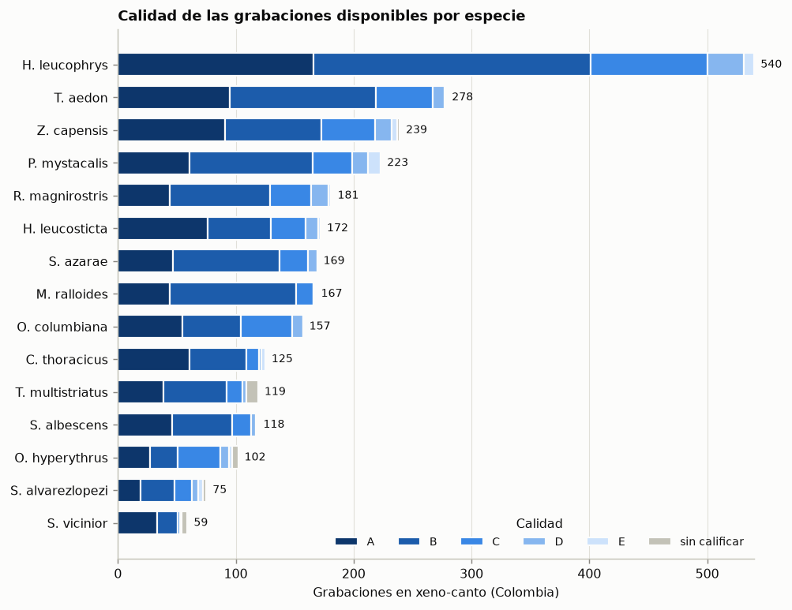

**Duración.** Es muy variable: mediana de 34 s, con el 10 % de las grabaciones por debajo de 10 s y el 10 % por encima de 98 s (máximo: 10 min). El 25 % supera los 60 s.

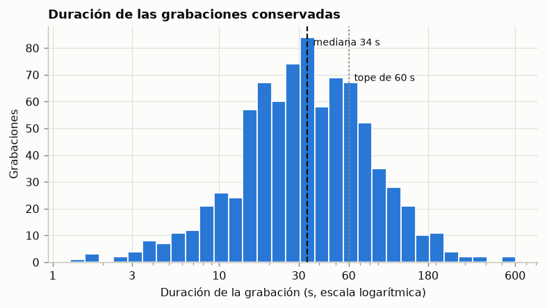

**Formato.** Los archivos vienen con ocho frecuencias de muestreo distintas (el 65 % a 44,1 kHz y el 32 % a 48 kHz; el resto entre 16 y 192 kHz) y el 61 % en estéreo, lo que hace obligatorio remuestrear y pasar a mono antes de extraer características. Solo 4 archivos (0,5 %) tienen una frecuencia de muestreo menor de 32 kHz y por tanto no contienen información en la parte alta del espectrograma.

**Etiquetas débiles.** El 13,4 % de las grabaciones conservadas declara otras especies al fondo (entre el 2 % en *S. alvarezlopezi* y el 24 % en *H. leucosticta*). Además, la etiqueta aplica a la grabación completa, no a cada ventana: hay ventanas con silencio, ruido u otras aves que heredan la etiqueta de la especie.

### B. Distribuciones

**Desbalance.** Es moderado, gracias al tope de 60 grabaciones por especie: entre 48 y 59 grabaciones y entre 589 y 928 ventanas por especie (razón máxima/mínima de 1,2 y 1,6). En minutos la diferencia es mayor (de 32 a 67), porque las grabaciones de *C. thoracicus* y *O. columbiana* son más largas.

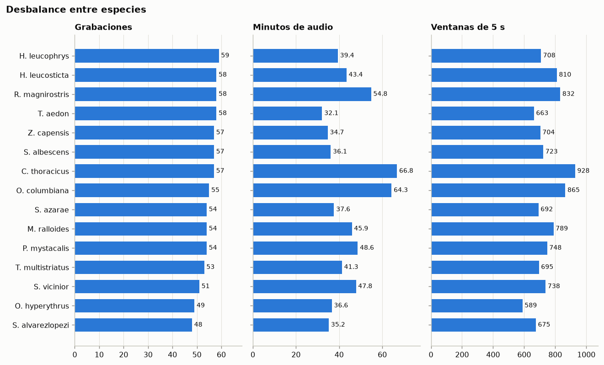

**Grabadores.** Cada especie tiene entre 17 y 39 grabadores distintos. La concentración es baja en general (el grabador principal aporta entre el 6 % y el 21 % de las grabaciones), con una excepción: en *C. thoracicus* una sola persona aporta el 30 %. Como la partición es por grabación y no por grabador, parte de las grabaciones de un mismo autor queda en entrenamiento y parte en prueba; lo anotamos como una posible fuente de optimismo en las métricas.

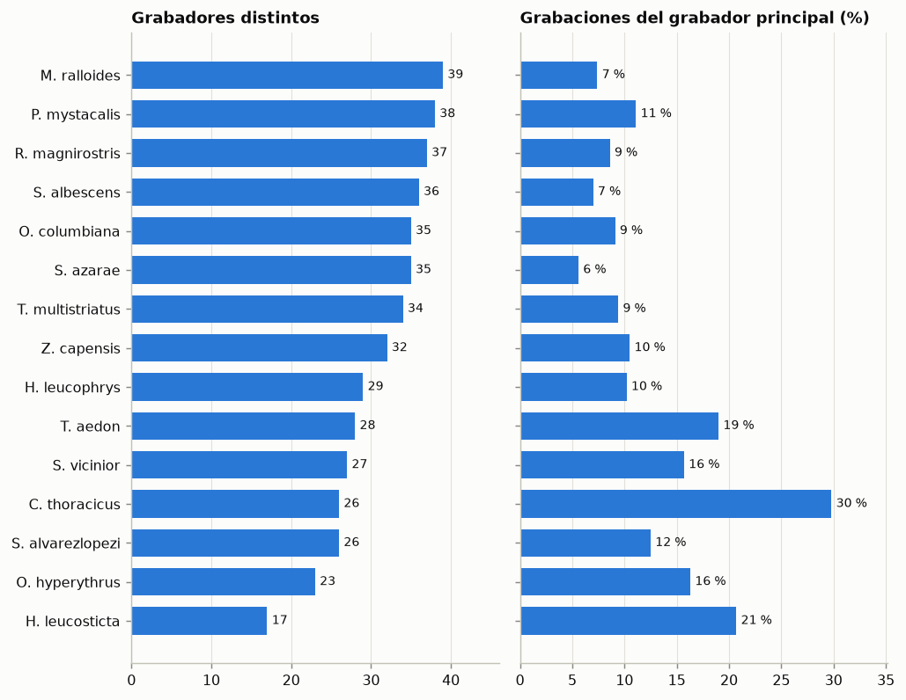

**Tipo de vocalización.** Las clases no son homogéneas por dentro: entre el 9 % y el 62 % de las grabaciones de cada especie no contienen cantos sino llamados u otros sonidos. *Rupornis magnirostris* (62 %), *Ortalis columbiana* (44 %) y *Scytalopus vicinior* (41 %) son las más heterogéneas: el modelo debe aprender varios tipos de sonido para la misma etiqueta.

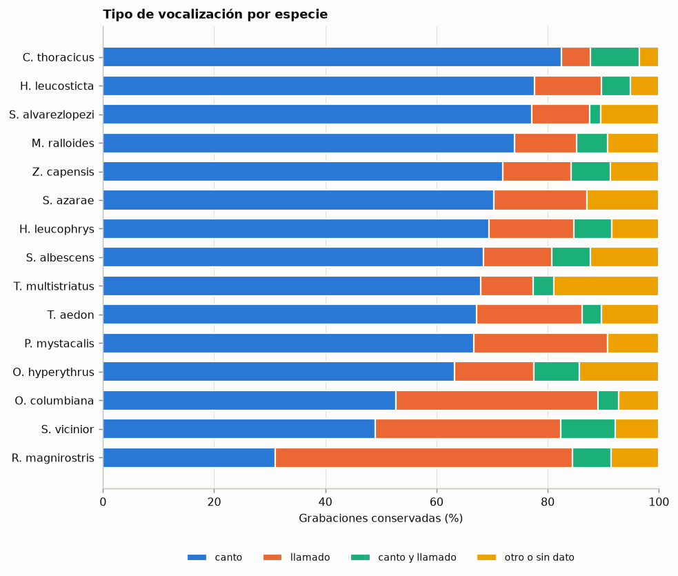

**Distribución geográfica.** De las 795 grabaciones con coordenadas, 100 (12,6 %) están dentro del rectángulo del Valle del Cauca; el resto se concentra en la región andina, al norte y al oriente del Valle. Los datos representan a los Andes colombianos más que al Valle en particular.

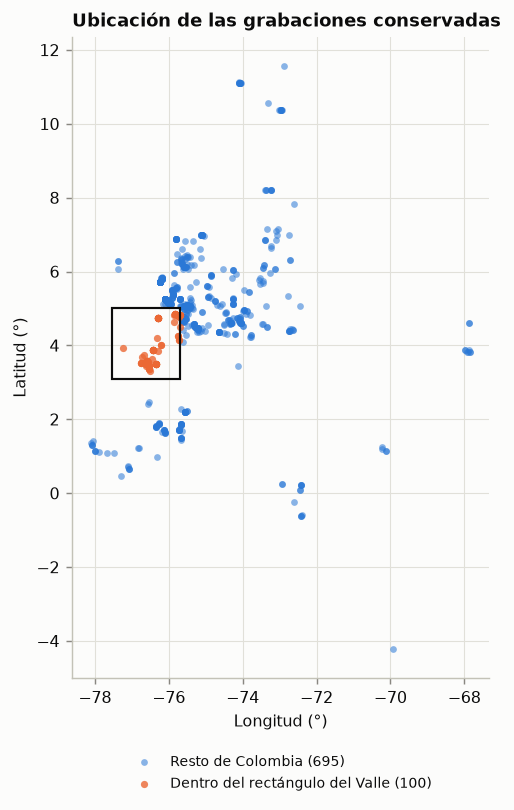

### C. Exploración acústica

**Espectrogramas.** La figura muestra, para cada especie, la ventana más parecida a su perfil promedio. Se aprecian firmas muy distintas: notas tonales sostenidas alrededor de 2–3 kHz en *C. thoracicus* y *S. vicinior*, series rítmicas de notas en *O. hyperythrus* y *T. multistriatus*, barridos amplios de frecuencia en *S. albescens* y *Z. capensis*, y armónicos apilados en *R. magnirostris*. También se ve ruido de fondo de banda ancha en varias grabaciones.

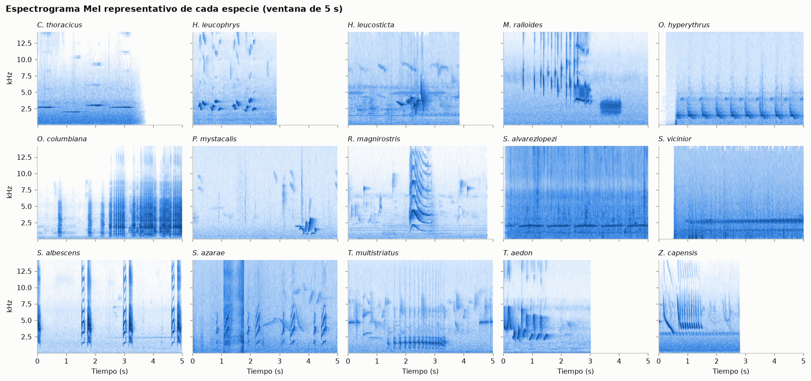

**Bandas dominantes.** Para cada especie calculamos el perfil espectral medio y le restamos el promedio de las 15 especies, de modo que queden las bandas que la distinguen. Nueve especies muestran una banda propia coherente con su vocalización: entre 1 y 2 kHz en *O. columbiana* y *O. hyperythrus*, entre 2 y 3 kHz en *S. alvarezlopezi*, *H. leucophrys*, *C. thoracicus* y *S. vicinior*, y entre 3,5 y 7,5 kHz en *S. albescens*, *T. aedon* y *H. leucosticta*. En las otras seis (*P. mystacalis*, *S. azarae*, *R. magnirostris*, *T. multistriatus*, *Z. capensis* y *M. ralloides*) lo que más las distingue queda por debajo de 1 kHz, donde estas aves no cantan: es **ruido de fondo de los sitios de grabación**. Es el hallazgo más importante de la exploración, porque el modelo podría usar ese ruido como atajo para reconocer la especie.

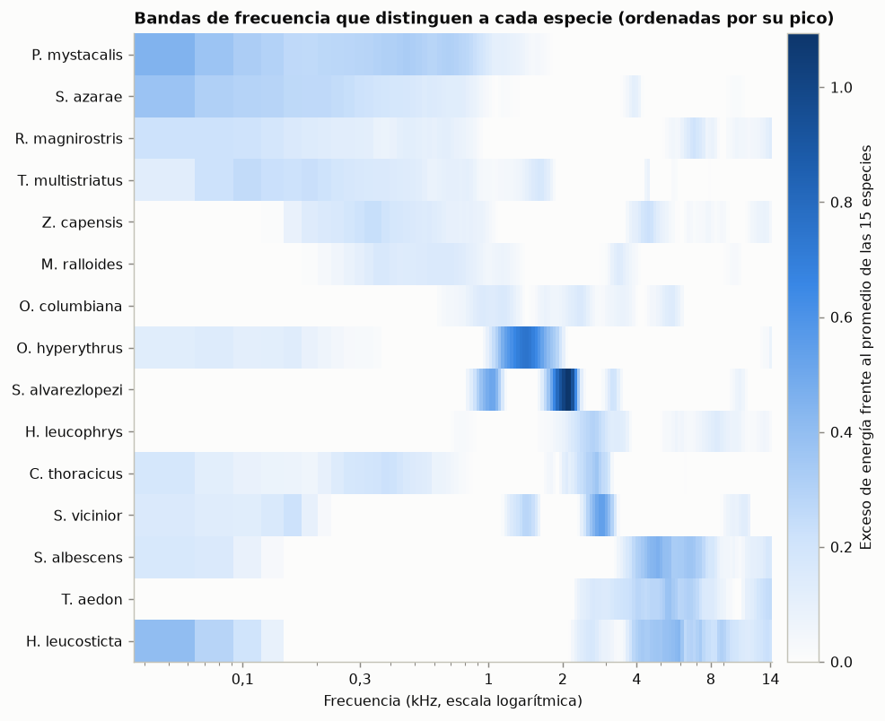

**Especies parecidas.** Medimos la distancia entre los centroides de las especies en el espacio de estadísticas de MFCC. Los pares más cercanos son *M. ralloides* – *R. magnirostris*, *P. mystacalis* – *T. multistriatus* y *H. leucophrys* – *T. aedon*. Salvo el último (dos cucaracheros), no son los pares del mismo género que esperábamos: con un resumen global de la ventana, el parecido lo determina más el ambiente de la grabación que el parentesco.

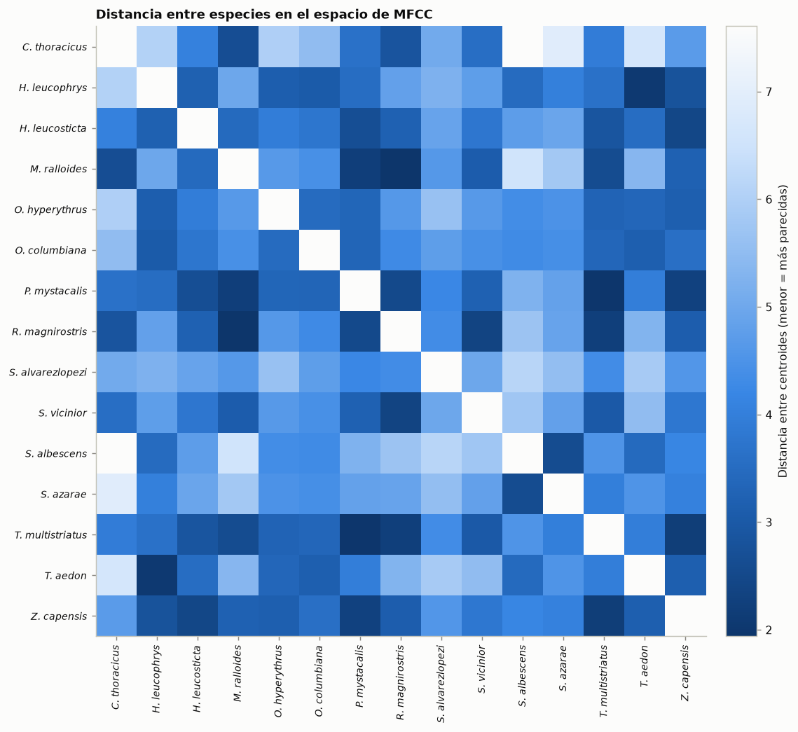

**Agrupamiento no supervisado.** Aplicamos k-means con k = 15 sobre las estadísticas de MFCC de las 11.159 ventanas. Los grupos coinciden poco con las especies: pureza de 0,26 (frente a 0,08 si se asignara todo a la clase mayoritaria), índice de Rand ajustado de 0,07 e información mutua normalizada de 0,19. La proyección en componentes principales lo confirma: cada especie ocupa una región algo distinta, pero las nubes se superponen. **Las vocalizaciones no se separan por especie sin usar las etiquetas**; hay señal, pero se necesitan modelos supervisados y, previsiblemente, representaciones que conserven la estructura tiempo-frecuencia.

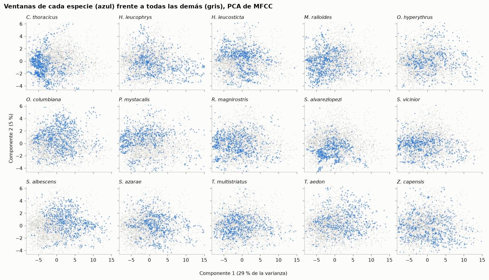

### D. Justificación de la selección de datos y variables

| Decisión | Valor | Justificación con base en el análisis |
|---|---|---|
| Calidades | A y B | Son el 75,5 % de lo disponible y bastan para llegar a ~55 grabaciones por especie; C–E agregarían grabaciones con el canto débil o tapado |
| Máximo por especie | 60 grabaciones | Limita el desbalance (razón 1,2 en grabaciones) aunque la especie más grabada tenga ocho veces más datos que la menos grabada |
| Descarte por especie objetivo al fondo | 44 grabaciones | Evita etiquetas equivocadas entre clases que sí evaluamos |
| Tope por grabación | Primeros 60 s | El 25 % de las grabaciones supera los 60 s; sin tope, unas pocas grabaciones largas dominarían su especie. Cuesta el 27 % de los minutos |
| Frecuencia de muestreo | 32 kHz, mono | Unifica ocho frecuencias de muestreo; cubre hasta 16 kHz y el 99,5 % de los archivos tiene al menos esa resolución |
| Ventana | 5 s, 50 % de solapamiento | Contiene frases completas (ver espectrogramas) y da 13,6 ventanas por grabación en promedio; el solapamiento evita cortar vocalizaciones en el borde |
| Espectrograma | 128 bandas Mel, 50 Hz – 14 kHz, en dB | Las bandas propias de las especies están entre 1 y 7,5 kHz; el rango las cubre con holgura. El límite inferior queda en revisión por el ruido de baja frecuencia |
| Normalización | Media 0 y desviación 1 por ventana | Compensa las diferencias de volumen entre equipos de 178 grabadores |

**Variables de los modelos.** Los **clasificadores clásicos** reciben 80 valores por ventana: la media y la desviación estándar en el tiempo de 20 MFCC y de sus deltas. Es un resumen compacto del timbre y de su variación, pero pierde el orden temporal. La **CNN** recibe el espectrograma Mel completo (128 × 501), que conserva la forma de las notas en el tiempo y la frecuencia. El conjunto final tiene **11.159 ventanas de 822 grabaciones**.

## IV. Hipótesis y diseño experimental (tarea 2.6)

Formalizamos las tres hipótesis preliminares de la Entrega 1 y agregamos una cuarta sobre los modelos clásicos que pide el curso. Fijamos el criterio de decisión antes de ver los resultados de prueba.

| Hipótesis | Predicción medible | Cómo la ponemos a prueba | Criterio de apoyo | Entrega |
|---|---|---|---|---|
| **H1.** Las representaciones preentrenadas superan a una CNN entrenada desde cero cuando hay pocas grabaciones por especie [7], [8] | Mayor F1 macro en prueba | CNN base frente a EfficientNet-B0 y *embeddings* bioacústicos, con la misma partición | Diferencia ≥ 0,05 en F1 macro | 3 |
| **H2.** La aumentación mejora las especies con menos datos [7], [9] | Mayor F1 en el tercio de especies con menos ventanas de entrenamiento | CNN base con y sin SpecAugment, mismo presupuesto de épocas | Diferencia media ≥ 0,02 en ese tercio | 2 |
| **H3.** Particionar por ventana sobrestima el desempeño | F1 macro con partición al azar por ventana mayor que con partición por grabación | Los mismos modelos (clásicos y CNN) con ambas particiones | Diferencia ≥ 0,05 en F1 macro | 2 |
| **H4.** La CNN sobre espectrogramas supera a los clasificadores clásicos sobre MFCC | Mayor F1 macro en prueba | CNN base frente al mejor clasificador clásico, misma partición | Diferencia ≥ 0,05 en F1 macro | 2 |

**Protocolo.**

- **Partición estratificada por grabación 70/15/15** con semilla 42 (`StratifiedGroupKFold`): 585 grabaciones (7.972 ventanas) para entrenamiento, 118 (1.593) para validación y 119 (1.594) para prueba. Ninguna grabación aporta ventanas a más de una partición, y la partición queda guardada en el índice para que todos los modelos usen exactamente la misma.
- **Métrica principal:** F1 macro por ventana. **Complementarias:** exactitud, exactitud balanceada, exactitud top-3, reporte por especie y matriz de confusión.
- **Selección y reporte:** elegimos el modelo (época de la CNN) con la validación y reportamos una sola vez sobre prueba. No ajustamos hiperparámetros con el conjunto de prueba.
- **Partición por ventana (solo para H3):** las ventanas se reparten al azar 70/15/15, estratificadas por especie, sin importar su grabación (columna `split_ventana`).
- **Alcance de la evidencia:** son pruebas iniciales con una sola semilla y un solo conjunto de prueba; tratamos los criterios como indicios y no como pruebas estadísticas. En la Etapa 3 repetiremos las comparaciones decisivas con varias semillas.

## V. Modelos de referencia y pruebas iniciales (tarea 2.7)

### A. Modelos

| Modelo | Entrada | Configuración |
|---|---|---|
| Clase mayoritaria | — | Predice siempre la especie más frecuente del entrenamiento |
| Regresión logística | 80 estadísticas de MFCC, estandarizadas | C = 1, pesos por clase balanceados |
| SVM | Igual | Núcleo RBF, C = 10, γ = `scale`, pesos por clase balanceados |
| Bosque aleatorio | Igual, sin estandarizar | 300 árboles, pesos balanceados por submuestra |
| Potenciación de gradiente | Igual, sin estandarizar | `HistGradientBoosting`, 200 iteraciones, tasa de aprendizaje 0,1 |
| CNN base | Espectrograma Mel 128 × 501 | 4 bloques (2 × Conv 3×3 + BatchNorm + ReLU, MaxPool, Dropout), 16–128 canales, *pooling* global y capa lineal: 295.647 parámetros. AdamW (tasa 1e-3, decaimiento 1e-4), lote de 32, pesos por clase, SpecAugment, hasta 12 épocas con parada temprana (paciencia 4) |

Los hiperparámetros de los modelos clásicos son valores estándar, sin ajuste: en esta etapa buscamos un piso de referencia, no el mejor modelo posible. La CNN es la arquitectura de `src/models/cnn_baseline.py` en su **versión liviana** (16 canales en el primer bloque en lugar de 32): entrenamos en CPU, sin GPU, y con 32 canales cada corrida habría tardado más del doble. En la Etapa 3 entrenaremos en GPU la versión completa.

### B. Resultados iniciales

**Desempeño en prueba con la partición por grabación** (1.594 ventanas de 119 grabaciones; tabla en [`comparacion_modelos_test.csv`](../experiments/results/comparacion_modelos_test.csv)):

| Modelo | Exactitud | Exactitud balanceada | F1 macro | Top-3 |
|---|---|---|---|---|
| Clase mayoritaria | 0,083 | 0,067 | 0,010 | 0,205 |
| Regresión logística (MFCC) | 0,578 | 0,577 | 0,567 | 0,769 |
| SVM RBF (MFCC) | 0,620 | 0,614 | 0,623 | 0,802 |
| Bosque aleatorio (MFCC) | 0,610 | 0,605 | 0,608 | 0,794 |
| Potenciación de gradiente (MFCC) | 0,593 | 0,591 | 0,590 | 0,803 |
| **CNN base (espectrogramas Mel)** | **0,734** | **0,730** | **0,735** | **0,871** |

La CNN base alcanzó su mejor F1 macro de validación (0,737) en la época 10 de 12, y ese es el modelo que evaluamos en prueba. Las curvas muestran que la pérdida de entrenamiento sigue bajando y que la validación oscila entre épocas (de 0,74 a 0,67 entre las épocas 10 y 12): el modelo aún no converge con este presupuesto.

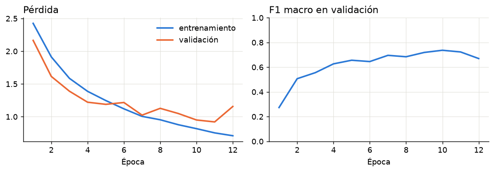

**F1 por especie de la CNN base** ([`cnn_base_test_por_especie.csv`](../experiments/results/cnn_base_test_por_especie.csv)):

| Grupo | Especies (F1) |
|---|---|
| Alto (≥ 0,85) | *C. thoracicus* (0,98), *S. azarae* (0,98), *O. columbiana* (0,95), *S. alvarezlopezi* (0,89), *O. hyperythrus* (0,86), *S. albescens* (0,85) |
| Medio | *S. vicinior* (0,77), *T. multistriatus* (0,68) |
| Bajo (< 0,65) | *Z. capensis* (0,63), *H. leucophrys* (0,62), *R. magnirostris* (0,60), *T. aedon* (0,57), *H. leucosticta* (0,56), *M. ralloides* (0,55), *P. mystacalis* (0,54) |

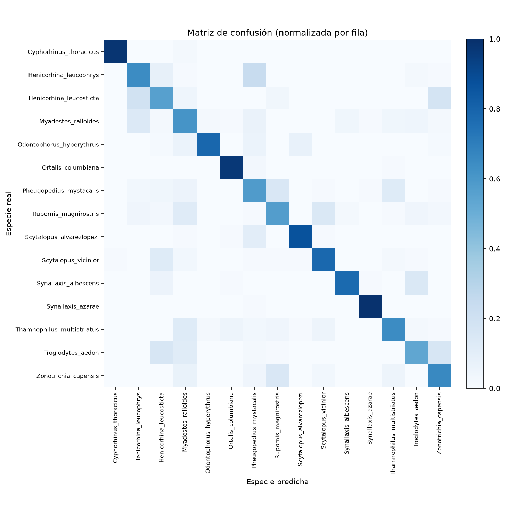

**Incertidumbre de la CNN base** ([`cnn_base_test_intervalos.json`](../experiments/results/cnn_base_test_intervalos.json)). Con 119 grabaciones de prueba, una cifra de F1 macro es aproximada, así que calculamos intervalos de confianza del 95 % por *bootstrap* (2.000 remuestras de grabaciones). El nivel "por grabación" promedia las probabilidades de las ventanas de cada grabación, que es como usaríamos el modelo con un audio nuevo.

| Nivel | F1 macro | Intervalo de confianza del 95 % | Remuestras con F1 ≥ 0,70 |
|---|---|---|---|
| Por ventana (1.594) | 0,735 | 0,661 – 0,782 | 75 % |
| Por grabación (119) | 0,817 | 0,740 – 0,873 | 99,7 % |

La exactitud por grabación es de 0,807. El nivel por grabación es más alto porque promediar ventanas corrige errores aislados.

**Pruebas de las hipótesis.**

| Hipótesis | Comparación | Resultado | Criterio | Decisión |
|---|---|---|---|---|
| **H4** | CNN base frente al mejor clásico (SVM), F1 macro | 0,735 frente a 0,623: **+0,112** | ≥ 0,05 | Recibe apoyo |
| **H3** | Partición por ventana frente a partición por grabación, F1 macro | CNN: 0,857 frente a 0,735 (**+0,122**); clásicos: de +0,140 a +0,340 | ≥ 0,05 | Recibe apoyo |
| **H2** | CNN con y sin aumentación, F1 medio en el tercio con menos datos | 0,796 frente a 0,794: **+0,002** | ≥ 0,02 | No recibe apoyo |

Detalle de H3 ([`h3_particion.csv`](../experiments/results/h3_particion.csv)):

| Modelo | F1 macro por grabación | F1 macro por ventana | Sobrestimación |
|---|---|---|---|
| Regresión logística | 0,567 | 0,707 | 0,140 |
| SVM RBF | 0,623 | 0,886 | 0,263 |
| Bosque aleatorio | 0,608 | 0,887 | 0,279 |
| Potenciación de gradiente | 0,590 | 0,930 | 0,340 |
| CNN base | 0,735 | 0,857 | 0,122 |

Detalle de H2 ([`h2_aumentacion_por_especie.csv`](../experiments/results/h2_aumentacion_por_especie.csv)): la CNN sin aumentación obtiene un F1 macro de 0,720 en prueba, frente a 0,735 con aumentación (+0,015). En el tercio de cinco especies con menos ventanas de entrenamiento la diferencia media es +0,002, con cambios por especie de −0,08 (*T. aedon*) a +0,08 (*S. alvarezlopezi*); en las otras diez es +0,022, de −0,07 a +0,18.

### C. Discusión

**La CNN supera a los modelos clásicos (H4).** La ventaja de 0,11 en F1 macro duplica el criterio que fijamos. Es coherente con el análisis exploratorio: el resumen global de MFCC pierde el orden temporal de las notas y por eso el agrupamiento apenas separaba las especies. Los cuatro clasificadores clásicos quedan entre 0,57 y 0,62, lo que sugiere que su techo lo impone la representación y no el clasificador.

**La partición por ventana infla todos los resultados (H3).** La sobrestimación va de 0,12 a 0,34 y es mayor en los modelos con más capacidad de memorizar (bosque aleatorio y potenciación de gradiente), que con esa partición pasarían de 0,59–0,61 a 0,89–0,93. Las ventanas solapadas de una misma grabación comparten ave, micrófono y ruido de fondo, así que el modelo reconoce la grabación y no la especie. En la CNN la sobrestimación es menor, pero esa corrida todavía mejoraba en la última época, así que con más épocas la brecha probablemente crecería. Mantenemos la partición por grabación como la única forma válida de reportar desempeño.

**La aumentación no favorece a las especies con menos datos (H2).** La diferencia en el tercio con menos datos es prácticamente nula y los cambios por especie tienen ambos signos. Vemos dos explicaciones. Primero, nuestro conjunto está casi balanceado (de 421 a 663 ventanas de entrenamiento por especie), de modo que el contraste que plantea la hipótesis es débil. Segundo, la mejora global de 0,015 es menor que la oscilación del F1 de validación entre épocas consecutivas (hasta 0,05), por lo que con una sola semilla no podemos distinguirla del ruido. Lo que sí observamos es que sin aumentación la pérdida de entrenamiento baja mucho más (0,43 frente a 0,71) sin mejorar la validación: la aumentación reduce el sobreajuste. La mantenemos y repetiremos la prueba con varias semillas.

**Las especies difíciles son las que anticipó el análisis exploratorio.** Las confusiones se concentran en los cucaracheros (*H. leucophrys*, *H. leucosticta*, *P. mystacalis* y *T. aedon*) y en *Z. capensis*, *M. ralloides* y *R. magnirostris*. Dos de los tres pares más cercanos en el espacio de MFCC (*H. leucophrys*–*T. aedon* y *M. ralloides*–*R. magnirostris*) están en este grupo, y *R. magnirostris* es además una de las especies con vocalizaciones más heterogéneas. En cambio, tener pocos datos no predice el desempeño: *O. hyperythrus*, la especie con menos ventanas, obtiene 0,86. La dificultad depende más de la similitud acústica y de la variedad de vocalizaciones que de la cantidad de datos.

**Meta de desempeño.** En la Entrega 1 propusimos un F1 macro de 0,80 y previmos recalibrarlo con el análisis exploratorio. Lo recalibramos a **aproximadamente 0,70** y lo medimos como una estimación con intervalo de confianza, no como un valor exacto. Tres razones, sacadas del EDA y de los resultados:

1. El F1 por especie varía de 0,54 a 0,98 con la CNN y depende de la similitud acústica y de las etiquetas débiles, no de la cantidad de datos. Un promedio de 0,80 obligaría a resolver las especies que el EDA mostró más difíciles (pares de cucaracheros, ruido de fondo, vocalizaciones heterogéneas).
2. Con 119 grabaciones de prueba y una semilla la incertidumbre es amplia: el intervalo del 95 % de la CNN va de 0,66 a 0,78 por ventana. Prometer un valor puntual alto sería arriesgado.
3. Nuestras 15 especies están bien documentadas (48 a 59 grabaciones cada una); el resultado no se extrapola a especies con pocos registros, así que damos un orden de magnitud y no una cifra exacta.

**Cómo la medimos:** F1 macro por grabación en prueba y por ventana, con intervalo de confianza por *bootstrap* sobre grabaciones (comando `intervalos`). Hoy la CNN base cumple la meta por grabación con holgura (0,82; intervalo de 0,74 a 0,87) y por ventana con incertidumbre (0,735; intervalo de 0,66 a 0,78). También informamos la mejora frente al piso de referencia (SVM, 0,62), con el criterio de apoyo de 0,05 de la sección IV.

**Transparencia:** fijamos el 0,70 después de ver los modelos de referencia (0,62 y 0,73), aplicando el criterio de la Entrega 1 de recalibrar tras el análisis exploratorio. Por eso no lo presentamos como una confirmación: la meta se pondrá a prueba con los modelos de la Etapa 3 y varias semillas. La exactitud top-3 de 0,87 indica además que la especie correcta suele estar entre las candidatas, lo que resulta útil para un prototipo que muestre varias opciones con su probabilidad.

**Limitaciones.** Usamos una sola semilla y un solo conjunto de prueba de 119 grabaciones, y calculamos intervalos de confianza solo para la CNN base. No ajustamos hiperparámetros. Y no hemos verificado si la CNN aprovecha el ruido de baja frecuencia que detectamos en seis especies, lo que podría inflar el desempeño fuera de xeno-canto.

**Ajustes al plan.** (1) Reportamos el desempeño por ventana y por grabación, con intervalos de confianza. (2) Evaluaremos un filtro pasa-altos antes de comparar modelos. (3) Repetiremos las comparaciones decisivas con al menos tres semillas. (4) Medimos el avance contra una meta aproximada de F1 macro de 0,70, con intervalos de confianza y no con un valor exacto.

## VI. Próximos pasos (Etapa 3)

1. **Poner a prueba H1.** Ajustar EfficientNet-B0 preentrenada [21] y entrenar un clasificador lineal sobre *embeddings* de un modelo bioacústico (BirdNET o Perch 2.0 [8], [16]), con la misma partición por grabación.
2. **Entrenar en GPU** (Google Colab) la CNN completa de 32 canales, con más épocas y ajuste de la tasa de aprendizaje, el tamaño de lote y la intensidad de la aumentación.
3. **Tratar el ruido de baja frecuencia:** comparar un filtro pasa-altos o una frecuencia mínima mayor del espectrograma, y revisar con mapas de activación qué bandas usa el modelo.
4. **Fortalecer la evaluación:** tres semillas o más e intervalos de confianza para todos los modelos, no solo para la CNN base.
5. **Atender las especies confundidas:** analizar los errores de los cucaracheros y probar *mixup* y mezcla con ruido de fondo.
6. **Prototipo de inferencia:** una aplicación que reciba un audio y devuelva las tres especies más probables.
7. **Cerrar el cronograma de la Etapa 3:** asignar un responsable a cada tarea (sin tareas "Por asignar") e incluir el video de 10 minutos, la presentación oral de la última sesión y la subida del reporte a la plataforma del curso.

## VII. Referencias

Mantenemos la numeración del [reporte 1](../../entrega_1/docs/reporte_entrega_1.md#viii-referencias) para las fuentes ya citadas y agregamos las nuevas.

[7] Y. Sun, T. M. Maeda, C. Solís-Lemus, D. Pimentel-Alarcón y Z. Buřivalová, "Classification of animal sounds in a hyperdiverse rainforest using convolutional neural networks with data augmentation," *Ecological Indicators*, vol. 145, art. 109621, 2022, doi: 10.1016/j.ecolind.2022.109621.

[8] B. Ghani, T. Denton, S. Kahl y H. Klinck, "Global birdsong embeddings enable superior transfer learning for bioacoustic classification," *Scientific Reports*, vol. 13, art. 22876, 2023, doi: 10.1038/s41598-023-49989-z.

[9] D. S. Park *et al.*, "SpecAugment: A simple data augmentation method for automatic speech recognition," en *Proc. Interspeech*, 2019, pp. 2613–2617.

[11] Xeno-canto Foundation, "xeno-canto: Sharing wildlife sounds from around the world." [En línea]. Disponible: https://xeno-canto.org

[12] B. McFee *et al.*, "librosa: Audio and music signal analysis in Python," en *Proc. 14th Python in Science Conference (SciPy)*, 2015, pp. 18–25.

[16] B. van Merriënboer, V. Dumoulin, J. Hamer, L. Harrell, A. Burns y T. Denton, "Perch 2.0: The Bittern Lesson for Bioacoustics," arXiv:2508.04665, 2025.

[21] M. Tan y Q. V. Le, "EfficientNet: Rethinking model scaling for convolutional neural networks," en *Proc. 36th International Conference on Machine Learning (ICML)*, 2019, pp. 6105–6114.

[22] Xeno-canto Foundation, "API v3 documentation." [En línea]. Disponible: https://xeno-canto.org/explore/api

[23] F. Pedregosa *et al.*, "Scikit-learn: Machine learning in Python," *Journal of Machine Learning Research*, vol. 12, pp. 2825–2830, 2011.

[24] A. Paszke *et al.*, "PyTorch: An imperative style, high-performance deep learning library," en *Advances in Neural Information Processing Systems 32 (NeurIPS)*, 2019, pp. 8024–8035.
