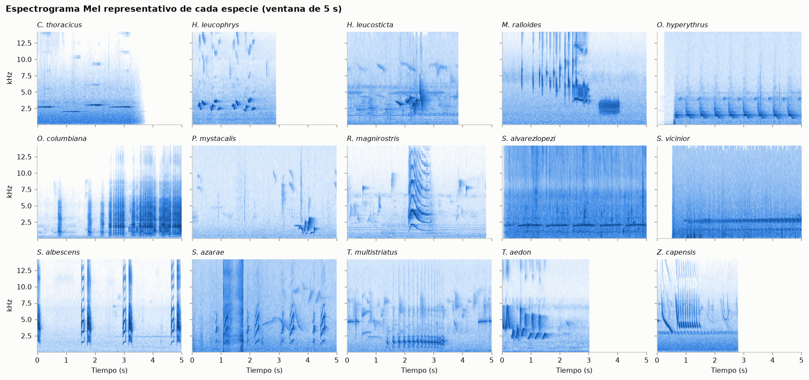
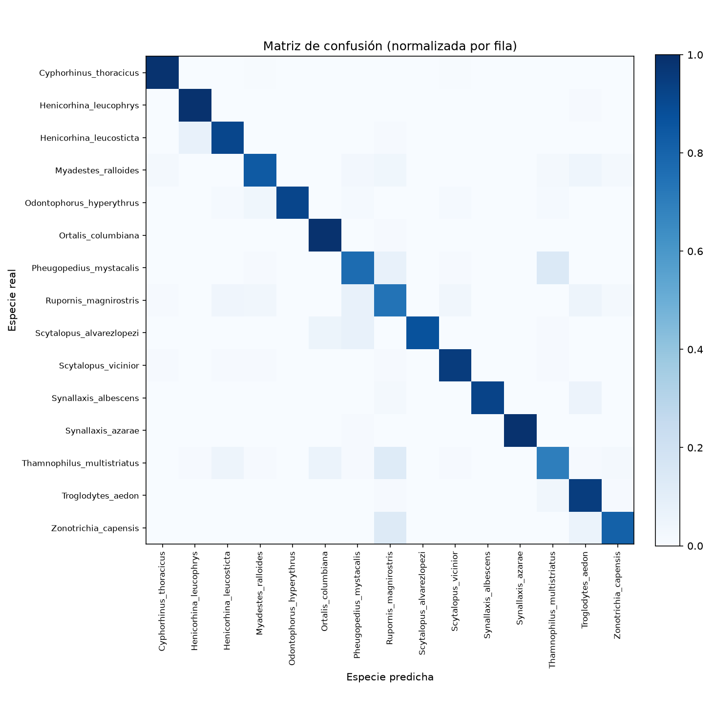
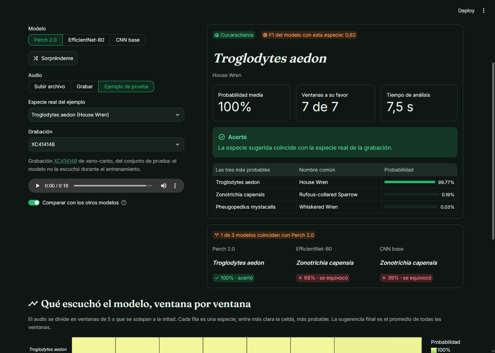

# Identificación de especies de aves de Colombia por su canto mediante aprendizaje profundo

**Reporte final · Entrega 3**

Proyecto 1 · Innovación Tecnológica con IA · **Grupo 4**  
Universidad Icesi · Facultad Barberi de Ingeniería, Diseño y Ciencias Aplicadas  
Integrantes: Wilson Ospina Pérez · Santiago Osorio · Martín Pérez · Adriana Zapata  
Fecha de entrega: 1 de diciembre de 2026

> **Estado del borrador.** Los resultados de los cinco enfoques ya están incluidos y verificados. Queda marcado con ⏳ el reemplazo de las referencias [1] y [2].

---

**Resumen.** Colombia es el país con más especies de aves del mundo, pero identificarlas por su canto depende de expertos escasos. En este proyecto construimos y evaluamos un sistema que, a partir de una grabación, sugiere las especies más probables entre 15 aves presentes en el Valle del Cauca. Con 822 grabaciones de xeno-canto (665 minutos) comparamos cinco enfoques —clasificadores clásicos sobre MFCC, una CNN entrenada desde cero, EfficientNet-B0 preentrenada en ImageNet y un clasificador lineal sobre *embeddings* del modelo bioacústico Perch 2.0— con una partición por grabación que evita la fuga de información. El clasificador sobre Perch 2.0 alcanza un F1 macro de 0,97 por grabación (intervalo de confianza del 95 %: 0,92–0,99), seguido de EfficientNet-B0 (0,90), la CNN propia (0,82) y el mejor clasificador sobre MFCC (0,79). La ventaja de Perch 2.0 se mantiene en grabaciones subidas a xeno-canto después de su entrenamiento, por lo que no se explica por fuga de datos. También mostramos que una partición por ventana sobrestima el F1 hasta en 0,34. Publicamos el código reproducible y un prototipo en Streamlit que responde en pocos segundos.

**Índice de términos.** Bioacústica, aprendizaje profundo, espectrograma Mel, transferencia de aprendizaje, *embeddings*, biodiversidad de Colombia.

---

## Contenido

- [I. Introducción](#i-introducción)
- [II. Problema, objetivos y alcance](#ii-problema-objetivos-y-alcance)
- [III. Estado del arte](#iii-estado-del-arte)
- [IV. Metodología](#iv-metodología)
- [V. Resultados](#v-resultados)
- [VI. Discusión](#vi-discusión)
- [VII. Conclusiones](#vii-conclusiones)
- [VIII. Limitaciones y trabajo futuro](#viii-limitaciones-y-trabajo-futuro)
- [IX. Referencias](#ix-referencias)
- [Anexo A. Reproducibilidad](#anexo-a-reproducibilidad)

---

## I. Introducción

Colombia ocupa el primer lugar mundial en diversidad de aves, con cerca de 1.954 especies registradas [1]. Buena parte de esa fauna se detecta con más facilidad por el oído que por la vista, y las grabadoras autónomas de monitoreo producen muchas más horas de audio de las que una persona puede escuchar. La bioacústica computacional responde a ese cuello de botella con modelos de aprendizaje profundo que clasifican vocalizaciones a partir de espectrogramas [3]; sin embargo, las herramientas globales tienen menor cobertura y exhaustividad para especies neotropicales poco documentadas [4], [5], [6].

En este proyecto construimos un sistema que, a partir de una grabación, sugiere las especies de ave más probables con su probabilidad. Trabajamos en tres etapas: en la primera analizamos el problema, el estado del arte y la planeación ([reporte 1](../../entrega_1/docs/reporte_entrega_1.md)); en la segunda construimos el conjunto de datos, hicimos el análisis exploratorio y entrenamos los modelos de referencia ([reporte 2](../../entrega_2/docs/reporte_entrega_2.md)); y en esta tercera comparamos cinco enfoques de clasificación, pusimos a prueba las hipótesis y construimos un prototipo de demostración.

**Aportes.** (1) Un conjunto de datos depurado y documentado de 15 especies con licencias y autores registrados. (2) Una comparación de cinco enfoques con la misma partición por grabación, las mismas métricas e intervalos de confianza. (3) Evidencia cuantitativa de cuánto sobrestima el desempeño una partición por ventana. (4) Un prototipo web y un *pipeline* reproducible con pruebas automáticas.

## II. Problema, objetivos y alcance

**Problema.** Baja capacidad para identificar de forma rápida, confiable y escalable las especies de fauna colombiana a partir de sus vocalizaciones.

**Pregunta de investigación.** ¿Puede un modelo de aprendizaje profundo, entrenado con grabaciones abiertas, identificar la especie que vocaliza en grabaciones no vistas con un F1 macro aproximado de 0,70 o más, estimado con intervalo de confianza?

**Objetivo general.** Desarrollar un prototipo basado en aprendizaje profundo que identifique, a partir de una grabación de audio, la especie de ave que vocaliza entre 15 especies presentes en el Valle del Cauca, con un F1 macro aproximado de 0,70 o más en grabaciones no vistas (estimado con intervalo de confianza) y devolviendo las especies más probables con su probabilidad.

| # | Objetivo específico | Indicador | Resultado |
|---|---|---|---|
| OE1 | Conjunto de datos depurado de fuentes abiertas, con licencias y autores | 10–20 especies con ≥ 30 grabaciones; 100 % con licencia y autor | ✅ 15 especies, 48 a 59 grabaciones cada una; 100 % documentadas |
| OE2 | *Pipeline* reproducible de preprocesamiento | Un comando por paso y pruebas automáticas | ✅ 9 comandos y 54 pruebas automáticas |
| OE3 | Comparar cinco enfoques de clasificación | Mismas particiones y métricas | ✅ 5 de 5: clásicos sobre MFCC, CNN base, EfficientNet-B0 y *embeddings* de Perch 2.0 con dos clasificadores |
| OE4 | Evaluar con partición por grabación y analizar errores | F1 macro ≈ 0,70 o más y top-3 cercana a 0,90, con intervalos | ✅ Perch 2.0 + regresión logística: 0,97 por grabación (0,92–0,99) y top-3 de 0,93 por ventana |
| OE5 | Interfaz de demostración | Responde en menos de 10 s por minuto de audio en CPU | ✅ Prototipo en Streamlit con tres modelos: mediana de 1,3 s (CNN base), 1,6 s (EfficientNet-B0) y 6,3 s (Perch 2.0) por minuto de audio |

**Alcance.** Clasificamos una especie principal por grabación entre 15 aves; la detección de varias especies superpuestas en paisajes sonoros largos, otros grupos de fauna y el despliegue en campo quedan fuera del alcance.

## III. Estado del arte

El enfoque dominante en bioacústica es aplicar redes convolucionales a espectrogramas Mel [3]. BirdNET [10] y Perch [16] son modelos entrenados con millones de grabaciones de miles de especies, y sus *embeddings* permiten entrenar clasificadores para especies nuevas con pocos ejemplos, con mejores resultados que entrenar desde cero [8]. En selvas hiperdiversas, Sun *et al.* mostraron que la aumentación de datos mejora las CNN cuando los datos son escasos [7]. Las competencias BirdCLEF, cuya edición 2025 se evaluó con grabaciones del Magdalena Medio colombiano [14], confirman el predominio de las CNN preentrenadas y de los ensambles. A la vez, BirdNET pierde exhaustividad en Centro y Suramérica [5] y Merlin cubre solo una fracción de las aves del país [6]: los modelos globales no resuelven por sí solos el caso colombiano. El detalle de los 9 trabajos revisados está en la sección V del [reporte 1](../../entrega_1/docs/reporte_entrega_1.md#v-estado-del-arte).

## IV. Metodología

Seguimos un marco CRISP-DM [20] adaptado: comprensión del problema, datos, preparación, modelado, evaluación y prototipo.

### A. Datos

- **Fuente:** xeno-canto, API v3 [11], [22], con licencias Creative Commons por archivo.
- **Selección de especies:** 15 especies con al menos 30 grabaciones de calidad A o B en Colombia y presencia confirmada en el Valle del Cauca; incluimos pares del mismo género para que la evaluación sea exigente (tabla II.B del [reporte 2](../../entrega_2/docs/reporte_entrega_2.md)).
- **Descarga y depuración:** 870 grabaciones de calidad A y B; descartamos 48 (44 con otra especie objetivo al fondo, 2 duplicadas y 2 de menos de 1 s). Quedan **822 grabaciones, 665 minutos y 178 grabadores**.

### B. Preprocesamiento

Audio mono a 32 kHz; primeros 60 s de cada grabación; ventanas de 5 s con 50 % de solapamiento; espectrograma log-Mel de 128 bandas entre 50 Hz y 14 kHz (128 × 501), estandarizado por ventana. Resultado: **11.159 ventanas**. Para los modelos clásicos calculamos 80 estadísticas de MFCC por ventana.

### C. Partición y métricas

- **Partición estratificada por grabación 70/15/15** (semilla 42): ninguna grabación aporta ventanas a dos particiones. Prueba: 1.594 ventanas de 119 grabaciones.
- **Métrica principal:** F1 macro, por ventana y por grabación (promediando las probabilidades de sus ventanas). **Complementarias:** exactitud, exactitud balanceada, exactitud top-3 y matriz de confusión.
- **Incertidumbre:** intervalo de confianza del 95 % por *bootstrap* con 2.000 remuestras de grabaciones.

### D. Modelos

| Enfoque | Entrada | Configuración |
|---|---|---|
| Clásicos (regresión logística, SVM, bosque aleatorio, potenciación de gradiente) | 80 estadísticas de MFCC | Hiperparámetros estándar, pesos balanceados |
| CNN base | Espectrograma 128 × 501 | 4 bloques convolucionales, 295.647 parámetros, SpecAugment, AdamW, 12 épocas |
| EfficientNet-B0 [21] | Espectrograma replicado en 3 canales | Pesos de ImageNet, ajuste completo, tasa de aprendizaje 3e-4, hasta 10 épocas (paciencia 3) |
| *Embeddings* de Perch 2.0 [16] | Audio crudo de 5 s a 32 kHz | Vector de 1.536 dimensiones por ventana + regresión logística y SVM |

Todos los modelos usan la misma partición. Elegimos la época de las redes con la validación y evaluamos una sola vez en prueba. Entrenamos en CPU (sin GPU).

### E. Hipótesis

| Hipótesis | Criterio de apoyo |
|---|---|
| **H1.** Las representaciones preentrenadas (EfficientNet-B0, Perch 2.0) superan a la CNN entrenada desde cero | Diferencia ≥ 0,05 en F1 macro |
| **H2.** La aumentación mejora las especies con menos datos | Diferencia media ≥ 0,02 en el tercio con menos ventanas |
| **H3.** Particionar por ventana sobrestima el desempeño | Diferencia ≥ 0,05 en F1 macro |
| **H4.** La CNN sobre espectrogramas supera a los clasificadores clásicos sobre MFCC | Diferencia ≥ 0,05 en F1 macro |

## V. Resultados

### A. Datos

El conjunto está casi balanceado (de 48 a 59 grabaciones y de 589 a 928 ventanas por especie), tiene etiquetas débiles (el 13 % declara otras especies al fondo) y una duración muy variable (mediana de 34 s). En seis especies la banda más distintiva está por debajo de 1 kHz, donde no cantan: es ruido de fondo de los sitios. Un agrupamiento no supervisado apenas separa las especies (pureza 0,26). El análisis completo está en la sección III del [reporte 2](../../entrega_2/docs/reporte_entrega_2.md).



### B. Comparación de modelos

F1 macro en prueba con partición por grabación, con intervalo de confianza del 95 % ([`experiments/results/`](../experiments/results/)):

| Modelo | F1 macro por ventana | F1 macro por grabación | Exactitud top-3 (ventana) |
|---|---|---|---|
| Regresión logística (MFCC) | 0,567 (0,48–0,62) | 0,718 (0,61–0,79) | 0,769 |
| SVM RBF (MFCC) | 0,623 (0,54–0,67) | 0,688 (0,58–0,76) | 0,802 |
| Bosque aleatorio (MFCC) | 0,608 (0,53–0,65) | 0,785 (0,69–0,85) | 0,794 |
| Potenciación de gradiente (MFCC) | 0,590 (0,51–0,64) | 0,697 (0,60–0,77) | 0,803 |
| CNN base | 0,735 (0,66–0,78) | 0,817 (0,74–0,87) | 0,871 |
| EfficientNet-B0 | 0,799 (0,73–0,83) | 0,901 (0,83–0,95) | 0,901 |
| **Perch 2.0 + regresión logística** | **0,878 (0,83–0,90)** | **0,966 (0,92–0,99)** | **0,931** |
| **Perch 2.0 + SVM** | **0,890 (0,84–0,92)** | **0,931 (0,88–0,97)** | **0,940** |

Los *embeddings* de Perch 2.0 son los mejores por amplio margen: sus intervalos por grabación ni siquiera incluyen el valor puntual de la CNN base (0,817). EfficientNet-B0 queda en segundo lugar: supera a la CNN base en ambos niveles, aunque sus intervalos se traslapan con los de la CNN y con los de Perch 2.0. Alcanzó su mejor F1 en validación (0,808) en la época 5 de 8; desde la época 3 la pérdida de validación subió mientras la de entrenamiento seguía bajando, una señal de sobreajuste que la parada temprana contuvo. Agregar por grabación sube el F1 de todos los modelos, porque promediar ventanas corrige errores aislados. El aumento es mayor en el bosque aleatorio (+0,18) que en el SVM (+0,07): al promediar puntajes de decisión en lugar de probabilidades, el SVM se beneficia menos.

### C. Pruebas de las hipótesis

| Hipótesis | Resultado | Decisión |
|---|---|---|
| **H1** | Perch 2.0 + regresión logística frente a la CNN base: 0,878 frente a 0,735 por ventana (+0,14) y 0,966 frente a 0,817 por grabación (+0,15). EfficientNet-B0: 0,799 frente a 0,735 por ventana (+0,06) y 0,901 frente a 0,817 por grabación (+0,08) | Recibe apoyo con ambos modelos preentrenados |
| **H2** | Con aumentación, 0,796 frente a 0,794 en el tercio con menos datos (+0,002) | No recibe apoyo |
| **H3** | La partición por ventana sobrestima el F1 entre +0,12 (CNN) y +0,34 (potenciación de gradiente) | Recibe apoyo |
| **H4** | CNN base 0,735 frente a SVM 0,623 por ventana (+0,11); por grabación, 0,817 frente al mejor clásico 0,785 (+0,03) | Recibe apoyo por ventana; por grabación la diferencia es menor que el criterio |

### D. Desempeño por especie

F1 por especie en prueba (por ventana) de la CNN base, EfficientNet-B0 y Perch 2.0 + regresión logística ([`efficientnet_b0_test_por_especie.csv`](../experiments/results/efficientnet_b0_test_por_especie.csv), [`perch_v2_regresion_logistica_test_por_especie.csv`](../experiments/results/perch_v2_regresion_logistica_test_por_especie.csv)). La última columna es el cambio de Perch 2.0 frente a la CNN base:

| Especie | CNN base | EfficientNet-B0 | Perch 2.0 + RL | Cambio |
|---|---|---|---|---|
| *Henicorhina leucosticta* | 0,558 | 0,803 | 0,919 | +0,36 |
| *Henicorhina leucophrys* | 0,620 | 0,640 | 0,913 | +0,29 |
| *Myadestes ralloides* | 0,551 | 0,637 | 0,804 | +0,25 |
| *Troglodytes aedon* | 0,575 | 0,754 | 0,822 | +0,25 |
| *Zonotrichia capensis* | 0,629 | 0,695 | 0,872 | +0,24 |
| *Pheugopedius mystacalis* | 0,539 | 0,692 | 0,778 | +0,24 |
| *Rupornis magnirostris* | 0,596 | 0,662 | 0,769 | +0,17 |
| *Scytalopus vicinior* | 0,769 | 0,762 | 0,924 | +0,16 |
| *Synallaxis albescens* | 0,847 | 0,920 | 0,950 | +0,10 |
| *Odontophorus hyperythrus* | 0,857 | 0,923 | 0,918 | +0,06 |
| *Scytalopus alvarezlopezi* | 0,890 | 0,879 | 0,930 | +0,04 |
| *Thamnophilus multistriatus* | 0,677 | 0,720 | 0,687 | +0,01 |
| *Ortalis columbiana* | 0,952 | 0,976 | 0,953 | 0,00 |
| *Cyphorhinus thoracicus* | 0,985 | 0,931 | 0,970 | −0,02 |
| *Synallaxis azarae* | 0,980 | 0,995 | 0,951 | −0,03 |

Perch 2.0 mejora sobre todo a los cucaracheros (*Henicorhina*, *Pheugopedius*, *Troglodytes*), que eran el punto débil de la CNN, y empata en las especies de canto estereotipado, donde la CNN ya estaba cerca del techo. La especie más difícil pasa a ser *T. multistriatus* (0,69). EfficientNet-B0 queda en medio en casi todas las especies: mejora a *H. leucosticta* (0,80) y *T. aedon* (0,75), pero sigue fallando con *H. leucophrys*, que predice de más (precisión de 0,51), y con *M. ralloides*, que deja de reconocer en la mitad de las ventanas (sensibilidad de 0,52).



### E. Verificación de fuga en Perch 2.0

Perch 2.0 se entrenó con grabaciones de xeno-canto, así que algunas de nuestras grabaciones de prueba pudieron estar en su entrenamiento. Si su ventaja viniera de "recordarlas", desaparecería en las grabaciones subidas después de su entrenamiento, que no pudo ver. Comparamos ambos grupos ([`fuga_perch_corte_2025-08-01.csv`](../experiments/results/fuga_perch_corte_2025-08-01.csv)):

| Modelo | Subidas antes de agosto de 2025 (107 grabaciones) | Subidas desde agosto de 2025 (12 grabaciones) |
|---|---|---|
| Perch 2.0 + regresión logística | 0,873 por ventana · 0,963 por grabación | 0,940 por ventana · 1,000 por grabación (12 de 12) |
| CNN base | 0,730 por ventana · 0,813 por grabación | 0,773 por ventana · 0,750 por grabación |

En las grabaciones que Perch no pudo ver acierta igual o mejor, y con un corte en enero de 2025 el resultado es el mismo (14 grabaciones, 14 aciertos). Con solo 12 a 14 grabaciones nuevas la comparación es indicativa, pero no muestra signos de que la ventaja se deba a la fuga.

### F. Prototipo

Construimos una aplicación en Streamlit ([`app/streamlit_app.py`](../app/streamlit_app.py)) con tres de los modelos: Perch 2.0 + regresión logística (el predeterminado), EfficientNet-B0 y la CNN base. El usuario sube o graba un audio, o elige una grabación de prueba, y obtiene:

- la especie más probable, con su grupo, si es endémica y el F1 del modelo con esa especie en prueba, para saber cuánto confiar en la sugerencia;
- las tres especies más probables con su probabilidad y un aviso cuando la confianza es baja;
- un mapa de calor con la probabilidad de cada especie en cada ventana de 5 s, que muestra cómo se construye la decisión, junto con el espectrograma;
- la comparación entre los tres modelos para el mismo audio.

Con las grabaciones de prueba, la app también dice si la sugerencia acertó. Otras dos pestañas explican cómo funciona el sistema y muestran la comparación de los cinco enfoques con sus intervalos de confianza.

Medimos el tiempo de inferencia en ocho grabaciones de prueba de 60 s en un portátil sin GPU (Intel Core i7-12700H). La mediana por minuto de audio es de 1,3 s con la CNN base, 1,6 s con EfficientNet-B0 y 6,3 s con Perch 2.0, que varía entre 4,8 y 14,8 s. Las redes propias cumplen el límite de 10 s de OE5 con holgura. Perch 2.0 lo cumple en la mediana, pero no en todas las grabaciones, y además tarda cerca de medio minuto en cargarse la primera vez. Para usarlo en la app instalamos TensorFlow en el mismo entorno que PyTorch, sin cambiar las versiones de las librerías de audio (ver [`instalacion.md`](instalacion.md)).



## VI. Discusión

- **La representación importa más que el clasificador.** Los cuatro clasificadores clásicos quedan agrupados entre 0,57 y 0,62 por ventana; la CNN, que conserva la estructura tiempo-frecuencia, los supera en 13 de 15 especies.
- **La forma de evaluar cambia la conclusión.** La partición por ventana infla el F1 hasta en 0,34, y la agregación por grabación lo sube hasta en 0,18. Reportar ambos niveles, con intervalos, evita conclusiones apresuradas: por grabación, el bosque aleatorio queda cerca de la CNN.
- **La dificultad depende de la acústica, no de la cantidad de datos.** Las especies más confundidas son las que el análisis exploratorio mostró más cercanas en el espacio de MFCC; la especie con menos datos (*O. hyperythrus*) obtiene 0,86.
- **Las representaciones preentrenadas ganan con claridad.** Un clasificador lineal sobre los *embeddings* de Perch 2.0, entrenado en segundos, supera a todos los modelos que entrenamos con nuestros datos, en especial en las especies parecidas entre sí. Coincide con lo reportado por Ghani *et al.* [8]: con decenas de grabaciones por especie, aprovechar un modelo entrenado con millones de grabaciones rinde más que aprender desde cero.
- **El preentrenamiento ayuda aunque venga de otro dominio, pero el del mismo dominio ayuda más.** EfficientNet-B0, preentrenada con fotografías de ImageNet, supera a la CNN base por 0,06 por ventana y 0,08 por grabación, aunque sobreajusta pronto y su entrenamiento tomó varias horas en CPU. Perch 2.0, preentrenado con sonidos de animales, rinde más y cuesta menos: basta un clasificador lineal entrenado en segundos sobre sus *embeddings*.
- **La fuga no explica la ventaja.** Como Perch 2.0 se entrenó con xeno-canto, verificamos su desempeño en grabaciones subidas después de su entrenamiento: acierta 12 de 12. La muestra es pequeña, pero la ventaja se mantiene.

## VII. Conclusiones

1. Con datos abiertos y entrenamiento en CPU es posible identificar 15 especies con un F1 macro de alrededor de 0,97 por grabación (Perch 2.0), 0,90 (EfficientNet-B0) y 0,82 con una CNN propia, por encima de la meta aproximada de 0,70.
2. Las redes sobre espectrogramas superan a los clasificadores clásicos sobre MFCC por ventana.
3. Evaluar con partición por grabación es indispensable: la partición por ventana sobrestima el desempeño hasta en 0,34.
4. Las representaciones preentrenadas superan a la CNN entrenada desde cero (H1): EfficientNet-B0 por 0,06 a 0,08 de F1 macro y los *embeddings* de Perch 2.0 por 0,14 a 0,15. La ventaja de Perch 2.0 se mantiene en grabaciones que el modelo no pudo ver.
5. Un prototipo en Streamlit permite usar los modelos sin conocimientos técnicos en un portátil sin GPU. Con las redes propias responde en menos de 2 s por minuto de audio, y con Perch 2.0, el más preciso, en una mediana de 6,3 s.

## VIII. Limitaciones y trabajo futuro

- **Limitaciones:** una sola semilla por modelo; 119 grabaciones de prueba; todas las grabaciones vienen de xeno-canto (no probamos grabaciones propias ni de grabadoras autónomas); etiquetas débiles por grabación; posible fuga en Perch 2.0, que solo pudimos verificar en 12 a 14 grabaciones nuevas; ruido de baja frecuencia que el modelo podría usar como atajo.
- **Trabajo futuro:** varias semillas y validación cruzada por grabación; filtro pasa-altos; detección de varias especies en paisajes sonoros; más especies, incluidas las poco documentadas; evaluación con grabaciones de campo del Valle del Cauca.

## IX. Referencias

> ⏳ **Pendiente:** reemplazar [1] y [2] (notas de prensa) por las fuentes primarias del SiB Colombia y del Instituto Humboldt o la UICN, como pidió el profesor.

[1] "Colombia vuelve a liderar el mayor conteo internacional de aves del mundo," *Forbes Colombia*, 15 de mayo de 2026. Cifras del SiB Colombia. ⏳ *Reemplazar por la fuente primaria.*

[3] D. Stowell, "Computational bioacoustics with deep learning: a review and roadmap," *PeerJ*, vol. 10, art. e13152, 2022, doi: 10.7717/peerj.13152.

[4] J. S. Cañas *et al.*, "Inteligencia artificial para la conservación y uso sostenible de la biodiversidad, una visión desde Colombia," arXiv:2503.14543, 2025.

[5] D. Funosas, E. Sebastián-González, J. Morant *et al.*, "A global assessment of BirdNET performance: Differences among continents, biomes, and species," *Ecological Indicators*, vol. 182, art. 114550, 2026, doi: 10.1016/j.ecolind.2025.114550.

[6] Cornell Lab of Ornithology, "Help expand Merlin in Colombia," *Merlin Bird ID*, 2025. [En línea]. Disponible: https://www.merlinbirds.org/help-expand-merlin-in-colombia/

[7] Y. Sun, T. M. Maeda, C. Solís-Lemus, D. Pimentel-Alarcón y Z. Buřivalová, "Classification of animal sounds in a hyperdiverse rainforest using convolutional neural networks with data augmentation," *Ecological Indicators*, vol. 145, art. 109621, 2022, doi: 10.1016/j.ecolind.2022.109621.

[8] B. Ghani, T. Denton, S. Kahl y H. Klinck, "Global birdsong embeddings enable superior transfer learning for bioacoustic classification," *Scientific Reports*, vol. 13, art. 22876, 2023, doi: 10.1038/s41598-023-49989-z.

[9] D. S. Park *et al.*, "SpecAugment: A simple data augmentation method for automatic speech recognition," en *Proc. Interspeech*, 2019, pp. 2613–2617.

[10] S. Kahl, C. M. Wood, M. Eibl y H. Klinck, "BirdNET: A deep learning solution for avian diversity monitoring," *Ecological Informatics*, vol. 61, art. 101236, 2021, doi: 10.1016/j.ecoinf.2021.101236.

[11] Xeno-canto Foundation, "xeno-canto: Sharing wildlife sounds from around the world." [En línea]. Disponible: https://xeno-canto.org

[14] J. S. Cañas *et al.*, "Overview of BirdCLEF+ 2025: Multi-taxonomic sound identification in the Middle Magdalena, Colombia," en *Working Notes of CLEF 2025*, CEUR Workshop Proceedings, vol. 4038, 2025.

[16] B. van Merriënboer, V. Dumoulin, J. Hamer, L. Harrell, A. Burns y T. Denton, "Perch 2.0: The Bittern Lesson for Bioacoustics," arXiv:2508.04665, 2025.

[20] P. Chapman *et al.*, *CRISP-DM 1.0: Step-by-step data mining guide*. SPSS Inc., 2000.

[21] M. Tan y Q. V. Le, "EfficientNet: Rethinking model scaling for convolutional neural networks," en *Proc. 36th International Conference on Machine Learning (ICML)*, 2019, pp. 6105–6114.

[22] Xeno-canto Foundation, "API v3 documentation." [En línea]. Disponible: https://xeno-canto.org/explore/api

[23] F. Pedregosa *et al.*, "Scikit-learn: Machine learning in Python," *Journal of Machine Learning Research*, vol. 12, pp. 2825–2830, 2011.

## Anexo A. Reproducibilidad

Desde `entrega_3/`, con el entorno de [`docs/instalacion.md`](instalacion.md):

```bash
python -m src.main baselines                                   # clásicos sobre MFCC, con intervalos
python -m src.main train --base-channels 16 --epochs 12 --patience 4 --run-name cnn_base
python -m src.main train --model efficientnet_b0 --lr 0.0003 --epochs 10 --patience 3 --run-name efficientnet_b0
python -m src.main evaluate   --checkpoint experiments/checkpoints/efficientnet_b0.pt
python -m src.main intervalos --checkpoint experiments/checkpoints/efficientnet_b0.pt

# Perch 2.0 (entorno aparte con TensorFlow)
python -m src.main embeddings --modelo perch_v2
python -m src.main baselines --features embeddings_perch_v2.npy --modelos regresion_logistica svm --prefijo perch_v2
python -m src.main fuga --corte 2025-08-01                    # verificación de fuga

streamlit run app/streamlit_app.py                             # prototipo
```
